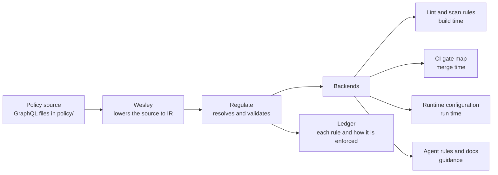

# Regulate

Regulate is a proposed compiler for engineering rules. You write a rule once, in a policy file. Regulate generates the configuration that your existing tools need to enforce it, fails the build when a rule has no enforcement, and keeps every exception in one file with an owner and an expiry date.

> **Status: nothing is built.** This repository holds the design and the plan for a pilot spike. The commands, generated files, and output below are the design, not captured results.

## The problem it addresses

A team decides a rule, such as "core code never reads the clock". Today that rule is written down several times: in a decision record, in linter configuration, in a CI script, in a list of exceptions, and in the instructions that AI coding agents read. Each copy is maintained by hand, so the copies drift, and nobody can list which written rules are actually enforced.

## How it would work



One policy source feeds four kinds of generated output and one report. Regulate does not analyse code beyond a text scanner. The linters, CI, and tests you already run do the enforcing.

Policy files use GraphQL schema syntax and are lowered by [Wesley](https://github.com/flyingrobots/wesley), a GraphQL schema compiler.

## One rule, end to end

The rule: code in `warp-core` never reads the wall clock.

**1. Write the rule once,** as a named bundle with its reason attached:

```graphql
"""
Governed code must not read the wall clock. A replay supplies time as data;
a clock read makes two runs of the same input diverge.
"""
interface NoWallClock
  @rustDisallow(methods: [
    { path: "std::time::SystemTime::now", use: "a caller-supplied timestamp" }
  ])
  @banPatterns(patterns: [
    { id: "time-system", regex: "\\bSystemTime::now\\b" }
  ])
```

**2. Apply it to a part of the repository:**

```graphql
"The simulation kernel."
type WarpCore implements NoWallClock
  @governs(paths: ["crates/warp-core/**"])
```

Wesley 0.3.0-alpha.3 lowers both files without error and keeps every rule and argument. That much has been checked. Everything from step 3 on is illustrative.

**3. Build.** Run:

```bash
regulate build
```

Regulate would write `crates/warp-core/.clippy.toml`:

```toml
# Generated by regulate. Do not edit.
disallowed-methods = [
  { path = "std::time::SystemTime::now", reason = "[regulate:warp-core/no-wall-clock/rust-disallow] Use a caller-supplied timestamp." },
]
```

The same source would also feed the text scanner, a generated section in `AGENTS.md`, and a documentation page.

**4. Verify in CI.** Run:

```bash
regulate verify
```

Regulate would run Clippy and the scanner, then report each rule:

```text
warp-core
  no-wall-clock/rust-disallow    FAIL   clippy
      crates/warp-core/src/tick.rs:41
      std::time::SystemTime::now is disallowed. Use a caller-supplied timestamp.
  no-wall-clock/ban-patterns     pass   scan
```

The failure names the rule, the file, and the fix.

**5. Record an exception,** when one is justified, in `policy/waivers.toml`:

```toml
[[waiver]]
policy  = "warp-core/no-wall-clock/ban-patterns"
path    = "crates/warp-core/tests/support/child_process.rs"
reason  = "Fixture deadline only; the value never reaches simulation state."
owner   = "architect"
expires = "2027-03-01"
```

An expired waiver would fail `regulate check`.

**6. Report.** `regulate report` would list every rule, what enforces it, and its waivers. A rule that no tool enforces would fail `regulate check` until someone adds enforcement or acknowledges the rule by name as manual.

## Terms

| Term | Meaning |
| --- | --- |
| Brick | A small reusable rule with typed parameters, such as `@rustDisallow` |
| Profile | A named bundle of bricks with a stated reason, such as `NoWallClock` |
| Subject | A named part of the repository that profiles and bricks apply to |
| Backend | A program that turns rules into one tool's configuration |
| Waiver | A recorded exception with a reason, an owner, and an expiry |
| Ledger | The report of every rule and how it is enforced |

## The pilot spike

The first step is a spike that can fail. It compiles Echo's ban on nondeterminism in `warp-core` from one policy source and compares the result with Echo's hand-written checks. The spike does not change Echo.

The spike passes when all four of these hold:

1. The compiled checks report the same violations as Echo's `scripts/ban-nondeterminism.sh` on a tree seeded with known violations: the same rule, path, and line for each.
2. The policy source for `warp-core` is shorter than the lists it replaces.
3. A second output for the same policy, a generated rules section for AI coding agents, takes less than one day to add.
4. The coverage report shows at least one rule that is written down but not enforced, or enforced twice in different ways.

The spike is planned as 24 tasks, about 52 estimated hours, in this repository's [issues](https://github.com/flyingrobots/regulate/issues). Each issue carries `issue-dag/2` frontmatter, so the dependency graph can be compiled from the issues themselves.

## Design documents

- [Executive summary](docs/proposal/executive-summary.md): the recommendation, the cost, and the open decisions.
- [Pitch](docs/proposal/pitch.md): the case for the idea, for a reader with no background.
- [Design specification](docs/proposal/design-spec.md): concepts, configuration, commands, and how it compares with current practice.
- [Technical design specification](docs/proposal/technical-design-spec.md): architecture, the backend protocol, what Wesley does and does not do, and the test plan.
- [Landscape and recommendation](docs/proposal/landscape-and-recommendation.md): neighbouring tools, what Regulate would replace, and whether to build it.

To work on this repository, read [AGENTS.md](AGENTS.md).

## License

Apache License 2.0. See [LICENSE](LICENSE).
