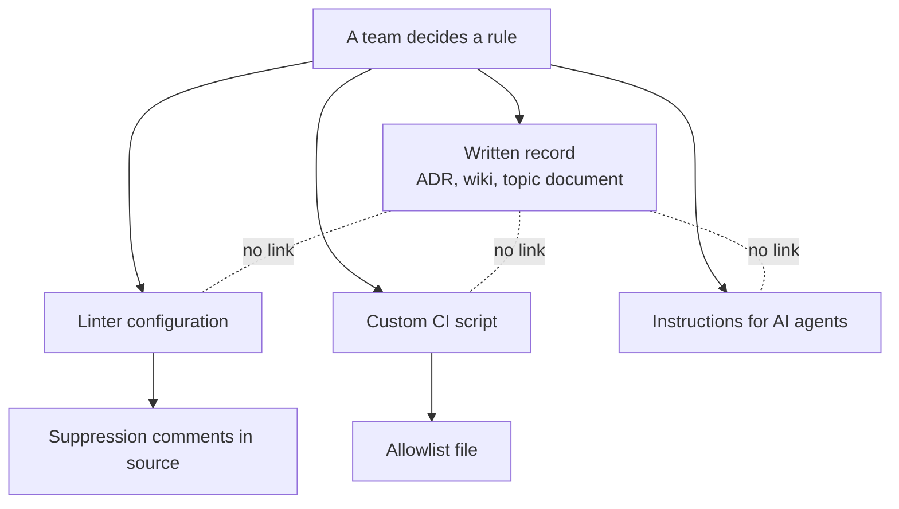
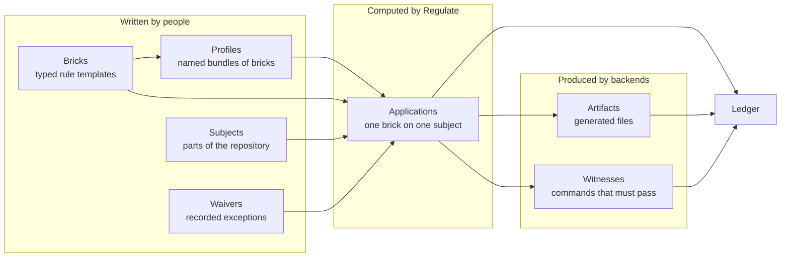
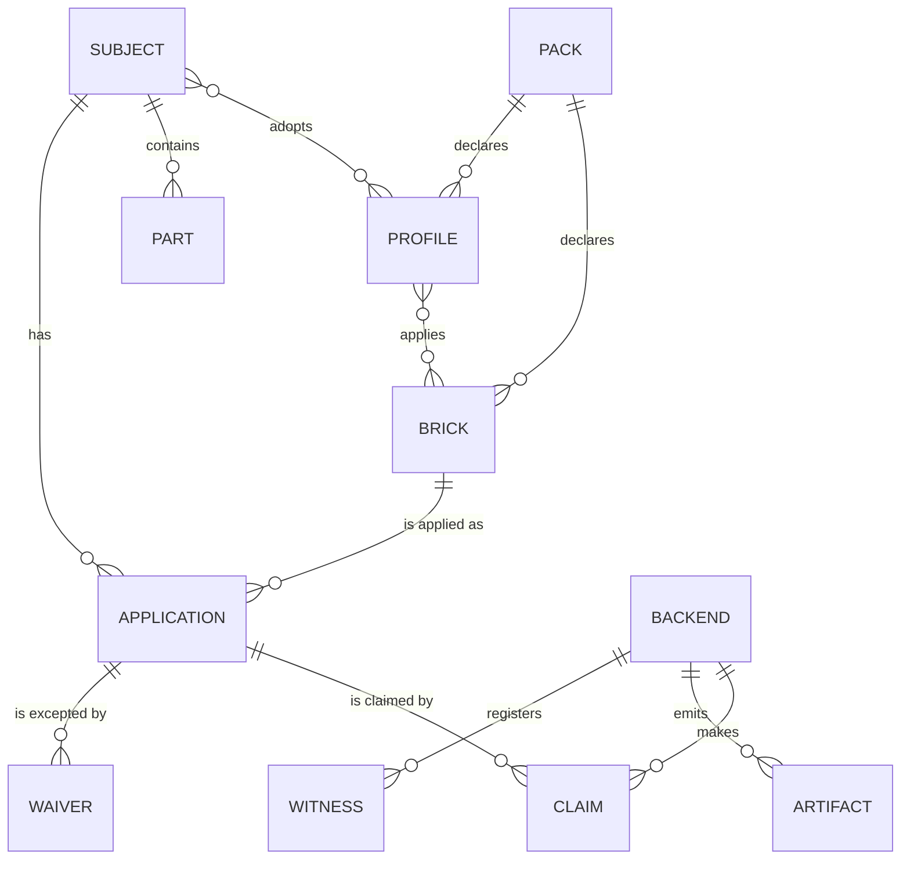
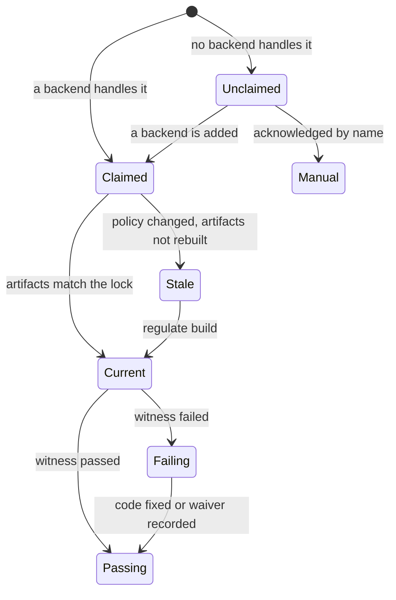
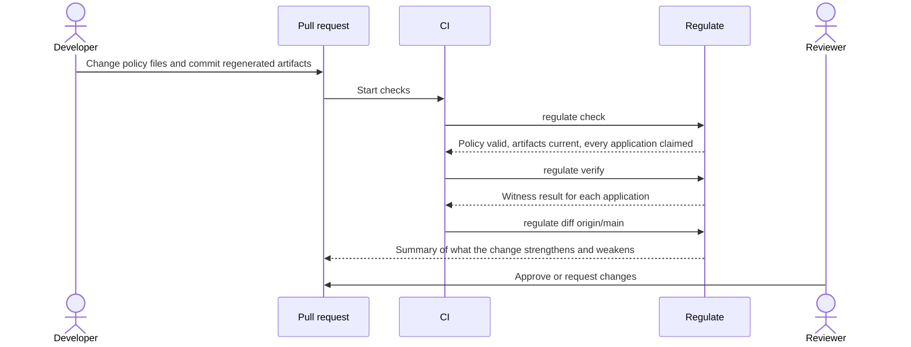

# Regulate design specification

What Regulate does, the ideas it is built from, how it is configured and used, and how it compares with current practice. The [technical design specification](technical-design-spec.md) covers how to build it.

> **Status.** Proposal, 14 November 2026. Regulate does not exist. Every command, file format, and output in this document is a design. An example is illustrative unless it is marked *observed*. Facts about existing repositories and about Wesley were checked on that date and say so.

This document assumes no background. It starts with the problem, then the model, then the detail. Read as far as you need.

## 1. What Regulate is

Regulate is a compiler for engineering rules. A person writes a rule once, in a policy file. Regulate generates the configuration that existing tools need to enforce that rule, checks that every rule has enforcement, and reports the result.

It has four jobs:

1. **Compile.** Turn policy files into linter settings, scan rules, CI gate maps, runtime configuration, instructions for AI coding agents, and documentation.
2. **Check coverage.** Fail when a rule has no enforcement and nobody has acknowledged that.
3. **Record exceptions.** Keep every exception in one file, with a reason, an owner, and an expiry date.
4. **Show changes.** Say in plain words what a change to the policy strengthens and what it weakens.

Regulate is not a linter and not a code analyser. It decides nothing about code by itself, except through one simple text scanner. The tools a team already runs do the enforcing.

## 2. Background

### 2.1 What a policy is

In this document, a *policy* is a rule that a team has decided its code or its process must follow. Policies come in several kinds, and each kind is enforced in a different place:

| Kind of rule | Example | Where it can be enforced |
| --- | --- | --- |
| What code may call | Core code never reads the clock | A linter, a text scan |
| How code is structured | Billing does not import from the web layer | A dependency checker |
| What must exist | Every core crate has a determinism test | A file check, a test run |
| How code behaves when it runs | Calls to the payment service retry at most five times | Generated runtime configuration |
| How changes are made | A release tag is never moved | A check when code is pushed or merged |

### 2.2 How a rule is enforced today

Four mechanisms do nearly all enforcement:

- A **linter** is a program that reads source code and reports patterns that break a rule. Clippy is the usual linter for Rust, and ESLint for JavaScript and TypeScript. A linter is told what to reject through a configuration file.
- **Continuous integration (CI)** is a service that runs a list of commands on every proposed change and blocks the change if a command fails. Teams add their own scripts to that list.
- A **test** runs the code and compares the result with an expected value.
- **Code review** is a person reading the change.

The first three are reliable because a machine runs them every time. Review is not, because the reviewer has to remember the rule.

### 2.3 How a rule is written down today

The common format is the **architecture decision record (ADR)**: a short numbered document that states a decision and its reasons. Records are added and rarely edited. When a decision changes, a new record is written and the old one is supposed to be marked as superseded.

The alternative is a **living topic document**: one current page per topic, such as `docs/topics/jobs/README.md`, edited in place whenever the rule changes. Version control keeps the history.

Either way, the written rule and its enforcement are separate files, connected only by the people who know they belong together.

### 2.4 Where current practice fails



The diagram shows one decision copied into four places, with two more places for exceptions. The dotted lines mark connections that exist only in people's heads.

Five failures follow. Each was found in a repository read for this proposal on 14 November 2026:

| Failure | Evidence |
| --- | --- |
| **The record goes stale.** | Echo's `docs/adr/ADR-0006-Ban-Non-Determinism.md` has the status "Superseded by: Executable repository policy and CI witnesses". Its text says that the copied paths and commands "drifted from the executable repository policy". |
| **One rule is built more than once.** | Echo bans unordered containers with regular expressions in `scripts/ban-nondeterminism.sh`. Bunny bans them by parsing Rust in `xtask/src/code_dojo.rs`, which is 1,419 lines. The two share no code. |
| **An unenforced rule looks like an enforced one.** | Shiplog's `docs/policy.md` marks the `ff_only` field by hand as "validated but not yet enforced" and two others as "Reserved; not yet honored". |
| **Exceptions scatter.** | Echo keeps 64 exceptions in two allowlist files, one per line as rule, path, and reason. Bunny keeps them in source as `dojo: allow <rule> -- <reason>` comments. Neither has an owner field or an expiry date. |
| **Policy values have no types.** | Amblicit's `docs/topics/release-process/policy.toml` is 488 lines of keys such as `mutation = "forbidden"`. Hand-written code reads each key, and a misspelt value is caught only where a test compares that exact string. |

A sixth failure is newer. AI coding agents read an instructions file at the start of each session, and that file is one more hand-maintained copy of the rules. An agent can also ignore it. A rule that matters has to be a gate as well as a sentence.

## 3. The model

### 3.1 The mental model



People write four things, on the left. Regulate works out every place a brick lands on a subject. Backends turn those into generated files and into commands that must pass. The ledger reports on all of it.

The model resembles building with interlocking bricks. A brick is small and does one thing. A profile snaps several bricks together under a name. A subject is where the assembly is placed.

### 3.2 A first example

This example follows one rule from source to report. The policy files are real in one sense: they were run through Wesley 0.3.0-alpha.3 and lowered without error. Everything Regulate does with them is illustrative.

**Step 1. Bundle two bricks into a profile.** The file `policy/profiles/determinism.graphql`:

```graphql
"""
Governed code must not read the wall clock. A replay supplies time as data;
a clock read makes two runs of the same input diverge.
"""
interface NoWallClock
  @rustDisallow(methods: [
    { path: "std::time::SystemTime::now", use: "a caller-supplied timestamp" },
    { path: "std::time::Instant::now", use: "a caller-supplied tick" }
  ])
  @banPatterns(patterns: [
    { id: "time-system", regex: "\\bSystemTime::now\\b" },
    { id: "time-instant", regex: "\\bInstant::now\\b" }
  ])

"""
Governed code must not use containers whose iteration order varies between
runs. Unordered iteration changes hashes and replay results.
"""
interface OrderedContainersOnly
  @rustDisallow(types: [
    { path: "std::collections::HashMap", use: "BTreeMap or IndexMap" },
    { path: "std::collections::HashSet", use: "BTreeSet or IndexSet" }
  ])

"""
Everything a replay-critical crate must satisfy.
"""
interface Deterministic implements NoWallClock & OrderedContainersOnly
```

The text in triple quotes is the rule's statement and its reason. It travels with the rule into every generated message and document.

**Step 2. Apply the profile to a subject.** The file `policy/subjects/warp-core.graphql`:

```graphql
"""
The simulation kernel. Two replays of one transcript must produce identical
state hashes.
"""
type WarpCore implements Deterministic
  @governs(paths: ["crates/warp-core/**"])
  @owner(name: "Architect")
  @requiresPaths(paths: ["crates/warp-core/tests/determinism_audit.rs"])
  @witness(name: "dind", run: ["cargo", "xtask", "dind"])
  @gates(required: ["G1", "G2", "G3", "G4"])
```

**Step 3. Build.** Run:

```bash
regulate build
```

Illustrative output:

```text
Lowered 2 policy files with wesley-core 0.3.0-alpha.3
Resolved 1 subject, 3 profiles, 6 applications
Wrote crates/warp-core/.clippy.toml      (clippy)
Wrote policy/generated/gates.json        (gates)
Wrote policy/regulate.lock
```

The generated `crates/warp-core/.clippy.toml`, illustrative and abridged to two entries:

```toml
# Generated by regulate (backend: clippy). Do not edit.
# Sources: policy/profiles/determinism.graphql, policy/subjects/warp-core.graphql

disallowed-methods = [
  { path = "std::time::SystemTime::now", reason = "[regulate:warp-core/no-wall-clock/rust-disallow] Use a caller-supplied timestamp." },
]
disallowed-types = [
  { path = "std::collections::HashMap", reason = "[regulate:warp-core/ordered-containers-only/rust-disallow] Use BTreeMap or IndexMap." },
]
```

**Step 4. Verify.** Run:

```bash
regulate verify
```

Illustrative output for a tree that contains one violation:

```text
warp-core
  no-wall-clock/rust-disallow              pass       clippy
  no-wall-clock/ban-patterns               pass       scan
  ordered-containers-only/rust-disallow    FAIL       clippy
      crates/warp-core/src/graph.rs:41
      std::collections::HashMap is disallowed. Use BTreeMap or IndexMap.
  requires-paths                           pass       evidence
  witness:dind                             pass       evidence
  gates                                    delegated  gates

4 passing, 1 failing, 1 delegated. Exit status 1.
```

The failure names the rule, the file, the line, and the fix. The developer does not need to find the decision record to learn why.

**Step 5. Report.** Run:

```bash
regulate report
```

Illustrative output:

```text
Policy coverage: 6 applications in 1 subject
  enforced    5
  delegated   1    warp-core/gates (consumed by CI)
  manual      0
  unclaimed   0
Waivers: 0 active
Artifacts: current
```

### 3.3 Concepts

Each term below has one meaning throughout this set.

**Subject.** A named part of the repository that rules apply to: a crate, a directory, a topic such as "jobs". A subject is written as a GraphQL object type with a `@governs` directive that lists its paths. A subject may have an owner.

**Part.** A named sub-area of a subject, written as a field on the subject's type. A part has its own paths and may carry rules that apply only to it.

**Brick.** The smallest unit of policy: one reusable rule with typed parameters. A brick is written as a GraphQL directive definition. `@rustDisallow` and `@banPatterns` are bricks. Most bricks are general mechanisms. Some are specific to a domain, such as `@retry(max:, backoff:)`.

**Profile.** A named bundle of bricks with a description, written as a GraphQL interface. `NoWallClock` is a profile. A profile is the unit a person thinks of as "a policy": it has a name, a statement, and a reason. A profile can include other profiles.

**Application.** One brick applied to one subject or part, with its arguments. Regulate computes applications from subjects and profiles. Each has a stable identifier: `warp-core/no-wall-clock/rust-disallow` means the `rustDisallow` brick, reached through the `NoWallClock` profile, on the `WarpCore` subject. A brick applied directly has a shorter identifier, such as `warp-core/gates`.

**Backend.** A program that turns applications into something that enforces or communicates them. One backend serves one mechanism: Clippy, the text scanner, the CI gate map, agent instructions.

**Claim.** A backend's statement that it handles an application. A claim has one of three kinds:

| Claim kind | Meaning | Example |
| --- | --- | --- |
| Enforcing | The backend registers a command that Regulate can run to prove the rule holds | Clippy with the generated configuration |
| Delegated | The backend emits a file for a system Regulate cannot observe | A gate map read by the CI service |
| Informational | The backend tells people or agents about the rule | A documentation page, an `AGENTS.md` section |

**Artifact.** A file a backend generates. Artifacts are committed to the repository so that editors and CI see them without running Regulate.

**Witness.** A command whose success is evidence that an application holds. `cargo clippy` using a generated configuration is a witness. So is a test harness that a person wrote and a policy file names.

**Waiver.** A recorded exception: one application, one path, a reason, an owner, and an expiry. A waiver is the only approved way to break a rule.

**Manual acknowledgement.** A line in the configuration that says a named application is not enforced by any machine, who answers for it, and why. It turns an invisible gap into a visible one.

**Ledger.** The report that lists every application with its claims, the state of its artifacts, its last witness result, and its waivers.

**Lock.** A generated file that records the digest of the policy input and of every artifact, so that a stale artifact is detected.

**Pack.** A versioned set of brick and profile declarations shared between repositories and pinned by digest.



The diagram shows how the concepts relate. The application is the centre: bricks and subjects produce it, backends claim it, and waivers except it.

### 3.4 Where enforcement happens

A rule can be enforced at four points. One policy source can feed all of them.

| Point | When | What a backend generates | Claim kind |
| --- | --- | --- | --- |
| Build time | While code is written and in CI | Linter configuration, scan rules | Enforcing |
| Merge time | When a change is pushed or merged | Gate maps, required-check lists, files such as Shiplog's `policy.json` | Delegated |
| Run time | While the program runs | Configuration or code for libraries such as Alfred and Nine Lives | Delegated |
| Guidance | Before code is written | Documentation pages, agent instruction sections | Informational |

Run time deserves a note. For a rule such as "retry at most five times", a lint is a weak check. A stronger approach generates the retry configuration itself, so the rule and the behaviour cannot differ. That holds only if the application code uses the generated configuration, which Regulate cannot observe. A scan rule that bans hand-built retry policies in the governed paths closes most of that gap.

### 3.5 The life of an application



An application starts either claimed or unclaimed. `regulate check` fails while any application is unclaimed or stale. `regulate verify` fails while any is failing. `Manual` is a resting state that stays visible in every report.

## 4. Configuring Regulate

### 4.1 Repository layout

```text
policy/
  regulate.toml            tool configuration
  profiles/
    determinism.graphql     profiles
  subjects/
    warp-core.graphql       one file per subject
  bricks/                   bricks declared by this repository, if any
  packs/                    shared packs, fetched and pinned
  waivers.toml              exceptions
  generated/                artifacts that have no natural home elsewhere
  regulate.lock            generated
```

Policy lives in `policy/` at the repository root. Documentation stays in `docs/`. A backend may write an artifact wherever its consumer expects it, such as `crates/warp-core/.clippy.toml`.

### 4.2 Policy files

Policy files use the syntax of the GraphQL schema definition language. GraphQL is normally used to describe web APIs. Regulate borrows three of its constructs and gives them these meanings:

| GraphQL construct | Meaning in a policy file |
| --- | --- |
| `directive @name(args) on …` | Declares a brick and its typed parameters |
| `interface Name @brick …` | Declares a profile |
| `type Name implements Profile @brick …` | Declares a subject, the profiles it adopts, and bricks applied directly |
| A field on a type | Declares a part |
| A description in triple quotes | The statement and reason for the thing it precedes |
| `input` and `enum` types | Parameter shapes for bricks |

Regulate would ship with a small set of bricks. The first version proposes these:

| Brick | Purpose | Handled by |
| --- | --- | --- |
| `@governs(paths:)` | The paths a subject or part covers, as globs from the repository root | Regulate itself; not a rule |
| `@owner(name:)` | The role or team that answers for a subject | Regulate itself; not a rule |
| `@rustDisallow(methods:, types:, macros:)` | Rust APIs that governed code must not use | `clippy` backend |
| `@banPatterns(patterns:)` | Text patterns that governed files must not contain | `scan` backend |
| `@requiresPaths(paths:)` | Files that must exist | `evidence` backend |
| `@witness(name:, run:)` | A command that must pass | `evidence` backend |
| `@gates(required:)` | CI gates that a change to the subject must pass | `gates` backend |

A repository declares its own bricks in `policy/bricks/` and supplies a backend that handles them.

### 4.3 `regulate.toml`

Illustrative:

```toml
[policy]
sources = ["policy/**/*.graphql"]
waivers = "policy/waivers.toml"

[[backend]]
name = "clippy"

[[backend]]
name = "scan"

[[backend]]
name = "evidence"

[[backend]]
name = "gates"
out  = "policy/generated/gates.json"

[[backend]]
name = "agents"
out  = "AGENTS.md"

[[backend]]
name = "eslint"
run  = ["node", "tools/regulate-eslint/main.js"]

[[manual]]
policy = "jobs/retry-budget-reviewed"
owner  = "reliability"
reason = "Needs human judgement; reviewed in the reliability sync."
```

| Key | Required | Meaning |
| --- | --- | --- |
| `policy.sources` | Yes | Globs for policy files |
| `policy.waivers` | No | Path of the waiver file; defaults to `policy/waivers.toml` |
| `backend.name` | Yes | A built-in backend, or a label for an external one |
| `backend.run` | For external backends | The command that starts the backend, as an argument list |
| `backend.out` | Depends on the backend | Where the backend's artifact goes |
| `manual.policy` | Yes | The identifier of an application with no enforcement |
| `manual.owner`, `manual.reason` | Yes | Who answers for it, and why no machine checks it |
| `pack.name`, `pack.source`, `pack.digest` | For each pack | A shared pack, its location, and the digest it is pinned to |

### 4.4 `waivers.toml`

Illustrative. The content follows a real entry in Echo's `.ban-nondeterminism-allowlist`:

```toml
[[waiver]]
policy  = "warp-core/no-wall-clock/ban-patterns"
item    = "time-instant"
path    = "crates/warp-core/tests/support/child_process.rs"
reason  = "Bounded deadline for an independent-process fixture; the value never reaches simulation state."
owner   = "architect"
expires = "2027-03-01"
```

| Field | Required | Meaning |
| --- | --- | --- |
| `policy` | Yes | The application identifier |
| `item` | No | One entry of a list-valued rule, such as one pattern |
| `path` | Yes | A file or glob the exception covers |
| `reason` | Yes | Why the exception is safe |
| `owner` | Yes | Who approved it |
| `expires` | Yes | A date, or the word `never` |

`expires` is required so that a permanent exception is a visible choice. `regulate check` fails on an expired waiver, on a waiver for an application that no longer exists, and on a waiver whose path matches no file.

### 4.5 Generated files and the lock

Each artifact starts with a header that says it is generated and names its sources. Artifacts are committed. `regulate check` rebuilds them in memory and fails if a committed artifact differs, so a hand edit or a forgotten rebuild is caught.

A backend owns the files it writes. Where a target format cannot be merged with hand-written settings, the hand-written settings move into the policy or into a pass-through block in `regulate.toml`. Clippy's configuration file is such a format.

## 5. Using Regulate

### 5.1 Commands

| Command | What it does | Writes files | Fails when |
| --- | --- | --- | --- |
| `regulate init` | Creates `policy/` with a starter configuration | Yes | The directory exists |
| `regulate build` | Compiles the policy and writes artifacts and the lock | Yes | The policy is invalid |
| `regulate check` | Validates the policy, coverage, artifact freshness, and waivers | No | Any of those is wrong |
| `regulate verify` | Runs every witness and attributes results to applications | No | A witness fails |
| `regulate report` | Prints the ledger as text, Markdown, JSON, or SARIF | No | Never, for a valid policy |
| `regulate explain <path or id>` | Shows which rules govern a file, why, and how each is enforced | No | The path or identifier is unknown |
| `regulate diff <revision>` | Compares the policy with another revision | No | Optionally, when the change weakens policy |
| `regulate waive` | Adds a waiver entry after prompting for the required fields | Yes | A required field is missing |

`check` is fast and runs no project tooling, so it suits a pre-commit hook. `verify` runs linters and tests, so it belongs in CI.

### 5.2 Adopt Regulate in an existing repository

Start small. The shortest route to a useful ledger wraps what already exists:

1. Run `regulate init`.
2. Declare one subject for the most important area of the repository.
3. Attach the checks that already exist as witnesses, for example `@witness(name: "code-dojo", run: ["cargo", "xtask", "code-dojo"])`.
4. Run `regulate build`, then `regulate verify`. The ledger now lists that area with its existing checks.
5. Move one hand-written list at a time into bricks. After each move, compare the generated artifact with the file it replaces, then delete the hand-written one.

Nothing has to migrate in one step, and existing checks keep running throughout.

### 5.3 Add or change a rule

1. Edit the profile or the subject.
2. Run `regulate build`.
3. Commit the policy change and the regenerated artifacts together.

If the new rule uses a brick that no configured backend handles, `regulate check` reports it:

```text
error[REG-C001]: jobs/resumable has no enforcement
  The brick @resumable is applied to subject Jobs, and no configured backend claims it.
  Add a backend that handles @resumable, or acknowledge it under [[manual]] in policy/regulate.toml.
```

This output is illustrative.

### 5.4 Record an exception

1. Add an entry to `policy/waivers.toml`, by hand or with `regulate waive`.
2. Run `regulate build`. Backends that support exceptions regenerate their artifacts.
3. Commit both.

A waiver takes effect in one of two ways, depending on the backend. Some targets accept an exception list, and the backend compiles waivers into it. The scanner and ESLint work this way. Other targets accept exceptions only as comments in source, as Clippy does. For those, the planned approach is an audit: the scanner finds each suppression comment in governed code and fails unless a waiver covers that file.

### 5.5 Review a policy change



The reviewer reads a summary instead of inferring the effect from a configuration diff. Illustrative `regulate diff` output:

```text
Policy changes against origin/main

Weakens
  - removed   jobs/no-ambient-randomness/ban-patterns
  - waiver    warp-core/no-wall-clock/ban-patterns on crates/warp-core/src/wal.rs (expires 2027-01-31)
Strengthens
  + added     billing/ordered-containers-only/rust-disallow
Changes
  ~ changed   jobs/retry    max: 5 -> 3
```

A removal, a narrowed path, a new waiver, a later expiry, and a new manual acknowledgement count as weakening. An argument change is reported without a direction, because Regulate cannot know whether 3 is stricter than 5.

### 5.6 Run Regulate in CI

Illustrative steps for a CI job:

```yaml
- run: regulate check
- run: regulate verify
- run: regulate diff origin/main --format markdown >> "$GITHUB_STEP_SUMMARY"
```

A team that prefers to keep its existing lint and test steps can run only `regulate check`. The generated configuration still drives those steps. The ledger then shows each application as compiled, without a witness result.

### 5.7 Find out what governs a file

Run:

```bash
regulate explain crates/warp-core/src/clock.rs
```

Illustrative output:

```text
crates/warp-core/src/clock.rs is governed by 1 subject

warp-core (owner: Architect)
  no-wall-clock
    Governed code must not read the wall clock. A replay supplies time as
    data; a clock read makes two runs of the same input diverge.
    Enforced by: clippy, scan
  ordered-containers-only
    Governed code must not use containers whose iteration order varies
    between runs.
    Enforced by: clippy
  Waivers on this file: none
```

The same command is how an AI coding agent would ask what applies before it edits a file.

## 6. Worked example: determinism in Echo and Bunny

Echo and Bunny both require deterministic code, and each built its own enforcement. This table maps what exists, as read on 14 November 2026, to what Regulate would hold. Line counts are from `wc -l`.

| Today | Lines | In Regulate |
| --- | ---: | --- |
| **Echo** `det-policy.yaml`: 26 crates, each with a class, paths, and an owner role; each class names required gates | 150 | One subject per crate with `@governs`, `@owner`, and `@gates`; each class becomes a profile |
| **Echo** pattern list in `scripts/ban-nondeterminism.sh`, plus `ban-globals.sh` and `ban-unordered-abi.sh` | 358 | `@banPatterns` inside profiles |
| **Echo** scan loop and waiver loading in `scripts/lib/determinism-scan.sh` | 172 | The built-in scanner |
| **Echo** `crates/warp-core/.clippy.toml` | 53 | `@rustDisallow`, and a generated file |
| **Echo** `.ban-nondeterminism-allowlist` and `.ban-globals-allowlist`, 64 entries | 79 | `policy/waivers.toml` |
| **Echo** `scripts/classify_changes.cjs`, which picks gates for a change | 103 | Reads the generated gate map |
| **Echo** replay harness, golden vectors, cross-platform runs | Not counted | Unchanged; named by `@witness` |
| **Bunny** crate lists and ban rules in `xtask/src/code_dojo.rs` | 1,419 | The checker stays as a witness at first; its lists can move into policy later |
| **Bunny** `dojo: allow <rule> -- <reason>` comments | In source | Waivers, checked by the suppression audit |
| **Bunny** rule that each core crate has a determinism test | In the checker | `@requiresPaths` |

Three points come out of the mapping:

- **The declarative parts move; the engines stay.** Lists of patterns, paths, crates, and exceptions become policy. The replay harness and Bunny's syntax-tree visitor are engineering that no compiler replaces.
- **A shared profile becomes possible.** Both repositories ban unordered maps, filesystem access, and floating-point shortcuts in core code. One `Deterministic` profile in a shared pack would give both the same rule.
- **How much shorter the policy is remains unmeasured.** The spike measures it. It is one of the four pass criteria.

## 7. Comparison with current practice

"Current practice" here means the combination most teams use: decision records or a wiki for the rule, hand-written linter configuration and CI scripts for enforcement, suppression comments for exceptions, and a hand-written instructions file for AI agents.

| Question | Current practice | Regulate |
| --- | --- | --- |
| Where does the rule live? | In a record, and again in each tool's configuration | In one policy file |
| How is enforcement created? | Someone writes configuration or a script for each tool | A backend generates it |
| Which rules are enforced? | Unknown without reading everything | Listed in the ledger; a gap fails the check |
| Where are the exceptions? | In comments and allowlists, one format per tool | In one waiver file, with owner and expiry |
| What does a failure tell the developer? | The tool's rule name | The policy identifier, the reason, and the fix |
| How is a rule changed? | Edit each copy and hope none is missed | Edit the policy and rebuild |
| How is a change reviewed? | Read configuration diffs | Read a summary of what is strengthened and weakened |
| How is history kept? | A chain of superseding records | Version control history of the policy file |
| How do AI agents learn the rules? | A hand-written file | A generated section, plus `regulate explain` |
| How do two repositories share a rule? | Copy and paste | A pinned pack |
| What does it cost to start? | Nothing new to learn | A new tool and an unfamiliar use of GraphQL |
| How flexible is it? | Unlimited; any script is allowed | Limited to what bricks and backends express, with witnesses as the escape hatch |

Current practice wins the last two rows, and those matter. For a single repository with a handful of rules, current practice is the better choice.

## 8. Who would use it

| Person | What they do with Regulate | What they get |
| --- | --- | --- |
| A maintainer of several repositories | Writes profiles once and applies them in each repository | The same enforcement everywhere, without rebuilding it |
| A staff engineer or architect | Owns the policy files and reviews changes to them | Proof that each rule holds, and a list of the ones that do not |
| A contributor | Reads failure messages and runs `regulate explain` | The reason for a rule at the moment it blocks them |
| A reviewer | Reads the policy diff on a pull request | The effect of a change without decoding configuration |
| A platform or developer-experience team | Publishes packs for the organisation | Standards that arrive as checks |
| A team lead working with AI coding agents | Generates agent instructions from policy and gates on the same rules | Guidance and enforcement that cannot disagree |
| An auditor or compliance owner | Reads the ledger and the waiver file | Evidence of what is enforced and who approved each exception |
| An AI coding agent | Reads generated instructions and calls `regulate explain` | The current rules for the files it is editing |

## 9. Extending Regulate

### 9.1 Write a backend

A backend is the extension point. It receives the resolved policy as structured data and returns three lists: the applications it claims, the files it wants written, and the commands that prove its rules hold. It writes nothing to disk itself. Regulate writes the files.

A backend can be a built-in module or any executable, in any language, that reads a request on standard input and writes a response on standard output. A team with a TypeScript codebase can write its ESLint backend in TypeScript and keep it in the repository. Section 8 of the [technical design specification](technical-design-spec.md) defines the protocol.

### 9.2 Share packs

A pack is a directory of brick and profile declarations with a version. A repository names the pack and the digest it expects. Regulate refuses a pack whose content does not match the digest, so a shared rule cannot change underneath its users.

### 9.3 Backends worth building

| Backend | Target | Enforcement point |
| --- | --- | --- |
| `eslint` | ESLint flat configuration: restricted imports, globals, and syntax | Build time |
| `semgrep` or `ast-grep` | Rule files for syntax-aware pattern engines | Build time |
| `archfit`, `dependency-cruiser`, `cargo-bylaw` | Configuration for dependency and layering checkers | Build time |
| `agents` | A managed section in `AGENTS.md`, `CLAUDE.md`, or per-path rule files | Guidance |
| `docs` | A generated policy page per subject or topic | Guidance |
| `alfred`, `ninelives` | Resilience configuration for JavaScript and Rust services | Run time |
| `shiplog` | `.shiplog/policy.json` | Merge time |
| `rulesets` | Branch and tag protection settings | Merge time |

### 9.4 Other directions

- **Importers.** A command that reads an existing `clippy.toml` or allowlist and writes the equivalent policy. This lowers the cost of adoption more than any other feature.
- **Standard report formats.** SARIF output lets code-scanning dashboards show Regulate results. An export to OSCAL, the control-catalogue format used in security compliance, is possible because the models are similar: a catalogue of controls, profiles that select them, and assessment results.
- **Advisory rules judged by a language model.** A backend could send a diff and a rule's statement to a model and report its opinion. Its claim would be informational, never enforcing, because the result is not repeatable.
- **Editor support.** Completion and validation for policy files, and a hover that shows the rules governing the open file.
- **A cross-repository ledger.** A service that collects ledgers from many repositories. This is where a commercial product would sit, if there were one.
- **A different authoring syntax.** The resolved policy model does not depend on GraphQL. A TOML or CUE front end could produce the same model.

## 10. Limits

- **Regulate cannot enforce what no tool can check.** "Handlers are idempotent" has no general static check. Regulate can require a test that exercises it, or record the rule as manual.
- **The target sets the granularity.** Clippy's configuration applies to a whole crate. A subject that covers part of a crate cannot be enforced through Clippy, and the backend says so.
- **A backend owns its files.** Hand-written settings in a generated file have to move.
- **Suppression comments bypass waivers** until the suppression audit exists for that tool.
- **Delegated claims are taken on trust.** Regulate confirms that the gate map is current. It cannot confirm that CI reads it.
- **Profiles take no parameters.** A profile is a fixed bundle. Two strictness levels need two profiles.
- **The policy files are not valid GraphQL for other tools.** A subject with no fields breaks a GraphQL validation rule. Wesley accepts it; a general GraphQL editor plug-in may flag it.
- **Witness commands are arbitrary commands.** A policy file can make CI run anything, so policy files need the same review as CI configuration.

## 11. Tradeoffs and alternatives

**Compile to existing tools, or run checks directly?** Archgate and ADG, the nearest existing tools, run their own checks. That gives one engine and one output format. Regulate compiles instead, for three reasons: the existing tools are better analysers than a new one would be, developers already see their output in editors, and a team keeps working if it stops using Regulate. The cost is that Regulate inherits each target's limits.

**GraphQL, or a configuration language?** GraphQL gives typed parameters, bundling through interfaces, descriptions, and an existing compiler with hashing and comparison. It was not designed for this, and section 10 lists the rough edges. TOML would be more familiar but would put each brick's parameter types in the tool's source code instead of in data, so adding a brick would mean changing the tool. CUE and Pkl are typed configuration languages that might suit outsiders better; they would not reuse Wesley. Because the syntax is isolated behind one interface, this choice can be revisited after the spike.

**Keep decision records as the source?** Archgate and ADG do, attaching checks to each record. That preserves the supersession problem: record 12 stays in the directory after record 54 replaces it. Regulate treats the current policy as the source and leaves history to version control.

**Use a language model as the enforcer?** A model can judge rules that no linter can. Its verdict varies between runs and costs money each time, so it cannot be a gate that developers trust. It fits as an advisory backend.

**Commit generated files, or generate them in CI?** Committing them means editors and local tools work without Regulate installed, and a reviewer sees the effect of a policy change. The cost is a larger diff. `regulate check` removes the risk of a stale file.

## 12. Open questions

1. **Subjects without fields.** Wesley lowers them. Should Regulate require a placeholder field so that the files remain valid for other GraphQL tools?
2. **Overriding a profile.** If a profile sets `@retry(max: 3)` and a subject wants 5, should a direct application override the profile? The current design says no: applications add up, and two values for a single-valued brick are a conflict. The alternative is an explicit override that the ledger marks.
3. **Identifiers for repeated bricks.** `@witness` can be applied several times and uses its `name` argument in the identifier. Should every repeatable brick be required to have a `name`?
4. **Naming collisions between packs.** GraphQL has no namespaces. Is a prefix convention enough?
5. **Baselines.** A repository with a thousand existing violations needs a way to start. Should `regulate waive --baseline` generate waivers for all of them, and how should those be distinguished from deliberate exceptions?
6. **Topic documents.** Should the documentation backend write into `docs/topics/<topic>/`, or keep generated pages in a separate directory?
