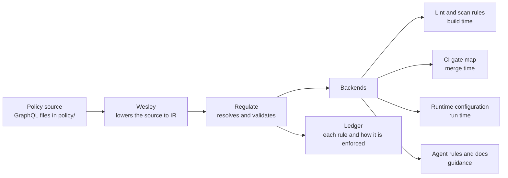

# Regulate: a policy compiler

Executive summary of a proposal for a tool that turns written engineering rules into enforced ones.

> **Status.** Proposal, 14 November 2026. Revised 15 November 2026 for the name and the spike estimate. Regulate does not exist. Its commands, file formats, and output are designs. An example in this set is illustrative unless it is marked *observed*.

## Recommendation

Run a pilot spike, then decide. On 15 November 2026 the spike was planned as 25 tasks with about 54 estimated hours of work, 20 of them on the critical path. Issue #1 in the repository holds the current figure. Do not commit to the full tool yet. Do not plan it as a commercial product.

The spike takes one policy that already exists, Echo's ban on nondeterminism in `warp-core`, and compiles it from one source into the checks Echo already runs. The spike passes when all four of these hold:

1. The compiled checks report the same violations as `scripts/ban-nondeterminism.sh` on a branch seeded with known violations: the same rule, path, and line for each.
2. The policy source for `warp-core` is shorter than the lists it replaces.
3. A second output for the same policy, a generated rules section for AI coding agents, takes less than one day to add.
4. The coverage report shows at least one rule that is written down but not enforced, or enforced twice in different ways.

If the spike passes, the next stage adopts the tool in Echo and Bunny and deletes the scripts it replaces. That stage is an estimated two to three weeks of one engineer's time. If the spike fails, extract a shared check library with a TOML file instead. That fallback removes the duplication between repositories without a new authoring language.

The [landscape and recommendation](landscape-and-recommendation.md) document gives the reasoning, the stop conditions for each later stage, and the parts that are not worth building.

## The problem

A team decides a rule, such as "core code never reads the clock" or "job handlers are idempotent". The rule then lives in several places that do not know about each other:

- **The written record:** an architecture decision record (ADR), a wiki page, or a contributing guide.
- **The enforcement:** linter configuration, a custom script, a test, a CI job.
- **The exceptions:** suppression comments and allowlist files.
- **The guidance for AI coding agents:** an `AGENTS.md` or `CLAUDE.md` entry.

Each copy is maintained by hand, so the copies drift. Nobody can answer the question "which of our written rules are actually enforced?" without reading all of them.

This is visible in repositories read for this proposal on 14 November 2026:

| What goes wrong | Where it shows |
| --- | --- |
| The written record goes stale | Echo's `ADR-0006-Ban-Non-Determinism.md` is marked "Superseded by: Executable repository policy and CI witnesses". Its own text says the prose drifted from the scripts. |
| One rule is built twice | Echo bans unordered maps with regular expressions in a shell script. Bunny bans them with a 1,419-line syntax-tree checker. |
| Unenforced rules look enforced | Shiplog's policy reference marks fields by hand as "validated but not yet enforced". |
| Exceptions scatter | Echo keeps 64 waivers in two allowlist files. Bunny keeps them as comments in source. Neither format has an expiry date. |
| Policy values have no types | Amblicit's 488-line `policy.toml` uses free strings such as `"blocked"`, checked only where a test happens to compare that string. |

## The proposal

Regulate is a compiler. Its input is a set of policy files. Its output is the configuration and checks that existing tools already consume.

The diagram shows one source feeding four kinds of output and one report. Nothing in the output is written by hand.

Four ideas carry the design:

- **Rules are typed bricks.** A brick is a small reusable rule with typed parameters. Bricks combine into named profiles such as `Deterministic`, and a profile is applied to a subject, which is a named part of the repository.
- **Backends compile, existing tools enforce.** A backend turns bricks into Clippy configuration, a ban list, a CI gate map, an agent rules section, and so on. Regulate contains no code analyser of its own beyond a text scanner.
- **Coverage is checked.** A rule that no backend enforces fails the build unless someone acknowledges it by name as manual. The ledger lists every rule with its status.
- **Exceptions are data.** One waiver file records each exception with a reason, an owner, and an expiry date.

## Why it is feasible now

The compiler front end exists. Wesley lowers GraphQL schema files to a hashed intermediate representation (IR), and Echo and Bunny already run generators over that IR. Wesley also defines a contract for external generators, with provenance records for what each one emitted.

Tests run for this proposal against Wesley 0.3.0-alpha.3 confirmed that the authoring model works as designed. Wesley keeps rule applications with their arguments, keeps profile membership, accepts subjects that have no fields, and reports rule changes in `wesley schema diff`. The spec's example policy files lower without error.

The same tests found what Wesley does not do. It does not check a rule's arguments against the rule's declaration, and its IR omits the declarations. Regulate has to do both. Section 3 of the [technical design specification](technical-design-spec.md) lists all twenty observations.

## Cost and risk

| Stage | Result | Estimated effort |
| --- | --- | --- |
| 0. Spike | One policy, two backends, pass or fail against the four criteria | About 54 hours in 25 tasks, as planned on 15 November 2026 |
| 1. Internal adoption | Waivers, ledger, policy diff; Echo and Bunny run on it | 2 to 3 weeks |
| 2. Wider use | Backends in any language, agent and docs output, shared rule packs | 3 to 4 weeks |
| 3. Publication | Open-source release, and a decision about further investment | Decided after stage 2 |

The estimates are judgement, not measurement. They assume one engineer who knows Rust and Wesley. The spike figure comes from a task-by-task plan; the first guess, two to three days, was less than half of it. The later stages have not been broken down, so expect them to grow in the same way.

The main risks:

- **The authoring language is unusual.** GraphQL was not designed for policy. If it reads badly in practice, the design allows a different syntax without changing the backends.
- **Value depends on backends.** A compiler with two backends helps two repositories. Outside adoption needs many more.
- **Wesley is pre-1.0.** Consumers pin different versions today: Echo pins 0.3.0-alpha.2 and Bunny pins 0.0.5.
- **The field is active.** At least five small projects address parts of this problem, and several published releases in 2026. None of the ones examined compiles to existing tools' configuration or reports coverage, but that can change.

## Decisions

Made on 15 November 2026:

- The name is Regulate. The crate name `regulate` was unclaimed on crates.io on that date. The npm name is held by an unrelated package.
- The spike targets Echo's `warp-core`, read at commit `089c849f766d5331835e7d10148a378cdb1237d5`.
- The repository is `flyingrobots/regulate`.

Still open:

1. Where rule declarations are read: inside Regulate, or in Wesley as a new output.
2. Whether the spike reads rule declarations at all. The current plan defers it.

## Where to read more

- [Pitch](pitch.md): the case for the idea in five minutes, for a reader with no background.
- [Design specification](design-spec.md): what the tool does, its concepts, how it is configured and used, and how it compares with current practice.
- [Technical design specification](technical-design-spec.md): architecture, data model, the backend protocol, the build plan, and the test plan.
- [Landscape and recommendation](landscape-and-recommendation.md): neighbouring tools, what Regulate would replace, who would want it, and whether to build it.
