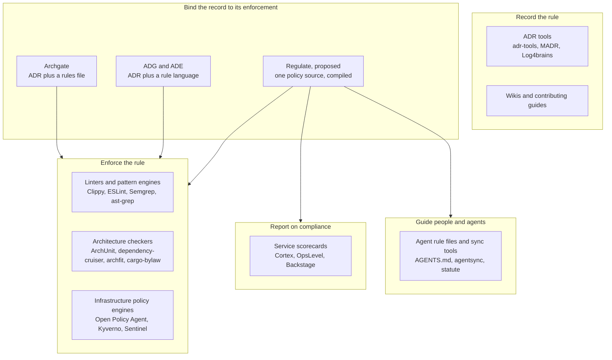
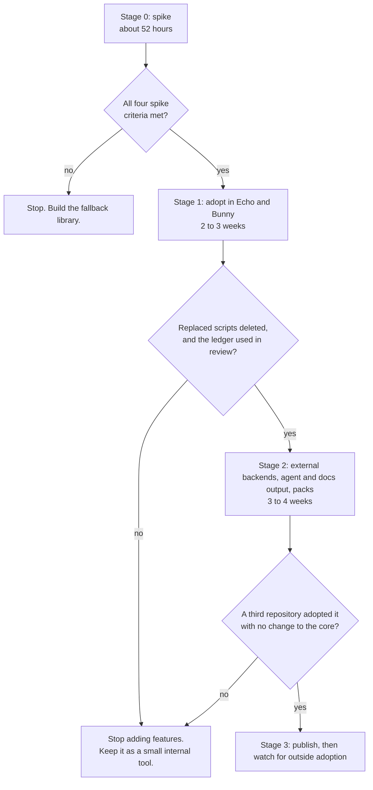

# Regulate: landscape and recommendation

Which existing tools come closest to Regulate, what it would replace, who would want it, and whether it is worth building.

> **Status.** Proposal, 14 November 2026. Regulate does not exist. Statements about other tools come from pages read on that date unless marked as general knowledge. No potential user was interviewed, and no market-size figure was found.

## 1. Verdict

| Question | Verdict |
| --- | --- |
| Build the pilot spike? | **Yes.** |
| Build the internal tool after the spike? | **Yes, if the spike meets its four criteria.** Otherwise build the fallback in section 9.3. |
| Publish it as open source? | **Decide after a third repository adopts it.** |
| Build it as a commercial product now? | **This isn't worth it; don't do this.** |
| Give it its own code analyser, or make a language model its enforcer? | **This isn't worth it; don't do this.** |

The rest of this document gives the evidence for each row.

## 2. How this was researched

**Read on 14 November 2026:** the repository or registry pages for Archgate, ADG, archfit, cargo-bylaw, and the `statute` crate; a Cortex article on policy as code; an Infosecurity Magazine article on an AI governance survey.

**Seen only as search-result summaries:** the agentsync and ai-rules-sync projects, ADR Guard, and a guide to architecture fitness functions. One JetBrains survey page returned an access error and was not read.

**Described from general knowledge, not re-checked:** ArchUnit, dependency-cruiser, import-linter, Semgrep, ast-grep, CodeQL, Open Policy Agent, Conftest, Kyverno, Sentinel, MegaLinter, Trunk, Projen, CUE, Pkl, Chef InSpec, OSCAL, SonarQube, and the ADR tools.

Star and commit counts are as shown on the day and are weak signals of maturity.

## 3. The shape of the field

Tools that deal with engineering rules fall into five groups by the job they do.

Four groups are crowded and mature. The fifth, binding a written rule to what enforces it, has two small tools and this proposal. Regulate differs from the other two by reaching the reporting and guidance groups as well, and by generating configuration for the enforcement group instead of running checks itself.

## 4. Nearest neighbours

### 4.1 Archgate

Archgate is an open-source command-line tool under the Apache-2.0 licence. Its repository describes it as "Enterprise-grade linting and guardrails for AI work". Decision records are Markdown files with front matter in `.archgate/adrs/`. Each record can have a companion `.rules.ts` file that exports checks. `archgate check` runs them, reports the file, line, and record that was broken, and exits with status 1 on a violation. Plugins let Claude Code, Cursor, and other agents read the records before writing code. The repository showed 74 stars and 612 commits.

**Like Regulate:** it binds a rule to a check, names the rule in the failure, and treats AI agents as a main audience.

**Unlike Regulate:** the decision record remains the source, so the supersession problem remains. Each check is TypeScript code written for one record. The page does not mention generating configuration for other tools, a report of unenforced records, or an exception format.

**Worth taking:** its failure output, and its agent plugins as a model for the agent backend.

### 4.2 ADG and ADE

ADG, for Architectural Decision Guidance, is a Go command-line tool under the Apache-2.0 licence. It manages decision records grouped into models. Its `adg enforce` command uses a companion tool, ADE. Rules are written in a domain-specific language in `.rule` files next to the records. `compile` turns rules into architecture tests for Go, .NET, and other targets through plugins, and `verify` checks rules against the file system. An MCP server lets AI assistants read records and validate rule files. The repository showed 60 stars and 13 commits on its main branch.

**Like Regulate:** this is the only neighbour found that compiles rules into another tool's form through plugins.

**Unlike Regulate:** it is centred on decision records, has its own rule language, and addresses architectural structure. The page does not mention coverage reporting or exceptions.

**Worth taking:** evidence that the compile-through-plugins design is workable.

### 4.3 archfit

archfit is a Go command-line tool under the Apache-2.0 licence. One file, `.archfit.yaml`, declares dependency rules: forbidden dependencies, layer directions, public-interface-only access, and cycles. It reads facts from existing analysers, including `go list`, dependency-cruiser, ast-grep, and `cargo metadata`, and supports Go, TypeScript, Python, and Rust. It has a baseline command, and its finding statuses include `waived` and `expired_waiver`. A failed check produces a repair task for an AI agent. Version 1.6.0 was published in July 2026, and its package page lists a version 3.

**Like Regulate:** one configuration across several languages, exceptions that expire, deterministic output for agents and CI.

**Unlike Regulate:** its rules are a fixed set about dependency structure. It does not cover banned APIs, required evidence, process rules, or runtime behaviour.

**Worth taking:** archfit is a good target for a Regulate backend. A `@boundaries` brick could compile to `.archfit.yaml` and inherit four languages of analysis.

### 4.4 cargo-bylaw

cargo-bylaw is an architecture checker for Rust under the MIT licence, described as inspired by ArchUnit. Rules live in `bylaw.toml` or in Rust tests and constrain dependencies between modules and crates. It is early: the repository showed 7 commits, and the crate was published at version 0.1.0 in August 2026.

It is a possible backend target for Rust dependency rules. It also holds the crate name `bylaw`.

### 4.5 Agent rule compilers

Three projects keep AI agent instruction files in step from one source. The `statute` crate describes itself as a tool to "Compile a constitution and chosen rules into the instruction files coding agents read"; it was created in October 2026. agentsync and ai-rules-sync generate `AGENTS.md`, `CLAUDE.md`, Cursor rules, and similar files from one canonical file.

These solve the guidance copy and nothing else. No result showed one that also generates linter configuration. An agent can still ignore the file.

### 4.6 Service scorecards

Cortex, OpsLevel, and Backstage's Tech Insights evaluate rules about services, such as "has an owner" or "runs secret scanning", and show the results per team. A Cortex article of 22 October 2026 argues that engineering standards must become machine-readable policy because AI agents carry no organisational context. The same article says of the product: "It does not write code, control agent output, or act as a PR gate."

Scorecards report across an organisation. They do not hold the rule's enforcement, and they do not look inside a repository's code.

### 4.7 Established categories

| Category | Examples | Relation to Regulate |
| --- | --- | --- |
| Architecture test libraries | ArchUnit, NetArchTest, dependency-cruiser, import-linter | Backend targets |
| Pattern engines | Semgrep, ast-grep, CodeQL | Backend targets; more precise than Regulate's text scanner |
| Infrastructure policy engines | Open Policy Agent with Conftest, Kyverno, Sentinel | A different domain: deployment and cloud configuration |
| Linter orchestrators | MegaLinter, Trunk, pre-commit | Run many tools; do not know which rule a tool implements |
| Project configuration generators | Projen | Generate tool configuration from one typed definition; the nearest precedent for compiling to configuration |
| Typed configuration languages | CUE, Pkl | Alternatives to GraphQL as the authoring syntax |
| Compliance models | Chef InSpec profiles and waivers, OSCAL | Prior art for profiles, expiring waivers with a justification, and assessment results |
| Quality platforms | SonarQube quality profiles and gates | A commercial version of "profile plus gate", inside one vendor's analyser |
| Language-model reviewers | Review bots with custom instructions | Can judge rules no linter can; results are not repeatable |

The compliance models deserve attention. InSpec's waiver file, with a control, a justification, and an expiry date, is the same shape as Regulate's waiver. OSCAL's catalogue, profile, and assessment results map onto pack, profile, and ledger. Regulate's model is a familiar one applied to a place where it is not yet used: rules inside a source repository.

## 5. Comparison

"Not found" means the page read did not mention it. It does not mean the tool lacks it.

| | Regulate (proposed) | Archgate | ADG and ADE | archfit | Linters and scripts | Scorecards |
| --- | --- | --- | --- | --- | --- | --- |
| Source of the rule | Policy files; current state only | Decision records plus rule files | Decision records plus rule files | One YAML file | Each tool's configuration | Rules in the vendor's platform |
| Rules are typed and reusable | Yes: bricks, profiles, packs | Rules are code, per record | A rule language | A fixed set of rule families | Per tool | Per platform |
| What enforces | Existing tools, through generated configuration | Its own engine | Generated architecture tests, or its own check | Its own engine over other analysers' facts | Each tool | Nothing; it reports |
| Reports rules with no enforcement | Yes; fails the check | Not found | Not found | Not applicable | No | Partly; shows failing rules |
| Exceptions with owner and expiry | Yes | Not found | Not found | Expiry yes; owner not found | One format per tool, no expiry | Varies |
| Kinds of rule | APIs, patterns, evidence, gates, runtime, with more by backend | Whatever the code checks | Architectural structure | Dependency structure | Whatever each tool supports | Service metadata |
| Guidance for agents from the same source | Yes | Yes | Yes | Repair tasks | No | Context through MCP |
| Works today | No | Yes | Yes | Yes | Yes | Yes |

The last row is the important one. Every alternative exists and Regulate does not.

## 6. What Regulate would replace

| Today | With Regulate |
| --- | --- |
| Marking old decision records as superseded, for rules that can be enforced | **Replaced.** The policy file is current by construction. |
| Hand-written ban lists in linter configuration | **Replaced** by generated configuration. |
| Pattern lists and scan loops in custom scripts | **Replaced** by `@banPatterns` and the built-in scanner. |
| Maps from paths to required CI gates | **Replaced** by a generated gate map. |
| Allowlist files, suppression conventions, and their loaders | **Replaced** by the waiver file; fully so only where the suppression audit exists. |
| Hand-kept tables of what is and is not enforced | **Replaced** by the ledger. |
| Hand-written agent instructions about code rules | **Replaced** by a generated section. |
| Copying rules between repositories | **Replaced** by pinned packs. |
| A tool that only syncs agent instruction files | **Replaced** for rules; not for other instructions. |
| Custom checkers, such as Bunny's syntax-tree checker | **Kept**, and named as witnesses. |
| Linters, analysers, and test harnesses | **Kept.** Regulate configures them. |
| Records of decisions that cannot be enforced, and their reasoning | **Kept** as prose. |
| Code review | **Kept.** |
| Infrastructure policy engines and scorecards | **Kept.** The ledger could feed a scorecard. |

In one sentence: Regulate replaces the bookkeeping around enforcement, not the enforcement.

## 7. Why now

Three observations, then an interpretation.

**Observation 1: AI coding tools are in general use, and oversight lags.** An Infosecurity Magazine article of 9 June 2026 reports a survey of 831 software engineers and DevOps professionals, carried out by UserEvidence for Black Duck in March 2026. It found 97% using AI coding tools and 30% with "a fully governed approach to oversight". The article does not define that phrase, and the survey was commissioned by a vendor. A search result summarising JetBrains' 2026 developer survey gave 90% weekly use of coding agents among professional developers; the page could not be opened, so that figure is unverified here.

**Observation 2: vendors are describing the same gap.** The Cortex article cited above argues that standards must be machine-readable because agents arrive without context.

**Observation 3: small tools are appearing.** cargo-bylaw was published in August 2026 and `statute` in October 2026. Archgate, ADG, and archfit address neighbouring parts of the problem.

**Interpretation.** Agents raise the cost of the old arrangement. A rule that lives only in prose was tolerable when the people writing code had absorbed it. An agent has not, produces changes faster than reviewers read them, and treats an unenforced rule as optional. That favours tools that make a written rule and its gate the same thing. The interpretation is this document's, not the sources'.

## 8. Who would want it

| Group | Why it fits | Strength of evidence |
| --- | --- | --- |
| Maintainers of several repositories with strict, shared rules | They rebuild the same enforcement per repository | Direct: five repositories read for this proposal each built their own |
| Teams that run AI coding agents heavily | They need rules as gates, and guidance that matches the gates | Indirect: surveys and vendor writing; no interviews |
| Codebases with replay, safety, or audit duties | They must show which rules hold and who approved each exception | Inferred from compliance practice; demand is unverified |
| Platform teams at mid-sized organisations | They publish standards and want them to arrive as checks | Inferred; these teams already buy scorecards |

**Who would not want it:** a team with one repository and a few rules; a team whose rules are all about infrastructure; an organisation committed to one vendor's quality platform.

**User and buyer differ.** The user is a staff engineer or maintainer. In a company, the budget for this kind of tool usually sits with a platform, security, or compliance function, and those buyers ask for dashboards and audit evidence, not a compiler.

**Barriers to adoption:**

- GraphQL is an unexpected language for policy.
- A compiler with few backends is of little use, and backends take work to write and maintain.
- A tool that owns generated files asks for trust.
- Existing configuration has to be imported, or the first day is a rewrite.

## 9. Should it be built

### 9.1 As an internal tool

The case against is plain. The existing scripts work. Counted in lines, Regulate loses: Echo's static determinism plumbing is about 900 lines across scripts, lists, and allowlists, and a compiler with a front end, a resolver, and backends will be larger than that.

The case for rests on four things that line counts miss:

1. **One model for exceptions and coverage.** Today no repository can list its unenforced rules or its expired exceptions, because neither concept exists in its tooling.
2. **Shared rules.** Echo and Bunny enforce overlapping determinism rules with unrelated code. A shared profile makes them the same rule.
3. **Guidance backed by gates.** The repositories are worked on by AI agents under written standards. Generating the agent instructions from the same source as the gates removes a copy that agents can drift from.
4. **A second use for Wesley's generator contract.** That contract exists, and Echo is the one consumer found. Policy is a second domain that would test whether it generalises.

If those four are wanted, the tool is worth building. If only the first two are wanted, the fallback in section 9.3 delivers them for less.

The spike exists to replace this judgement with evidence. Its criteria are in the [executive summary](executive-summary.md).

### 9.2 As a product

**As open source:** plausible for a niche, after it has proved itself internally. It would need importers for existing configuration and perhaps five or more backends before an outside team could adopt it in a day. The neighbouring projects are small, and none dominates, which means the field is open and also that demand is unproven.

**As a business:** this isn't worth it; don't do this. The reasons:

- **The buyer wants something else.** Section 8 explains that budgets sit with functions that buy dashboards and audit evidence.
- **Incumbents own both ends.** Quality and security vendors own enforcement. Scorecard vendors own reporting. A compiler between them is a feature either could add.
- **No demand has been measured.** This proposal found no market-size figure and interviewed nobody. The evidence is one maintainer's repositories and some survey headlines.
- **The cost of finding out is low without a company.** Publishing the tool and watching whether anyone adopts it answers the question.

If a business ever exists here, it is a hosted ledger across many repositories with compliance exports. That is a different product, and the open-source tool would be its prerequisite.

**Two things not to build at all:**

- **An analyser.** Semgrep, ast-grep, Clippy, and ESLint are years ahead. Regulate's text scanner should stay crude.
- **A language-model enforcer at the core.** It would make the gate unrepeatable. It fits as an optional advisory backend.

### 9.3 The cheaper fallback

Extract the shared parts into a small Rust library and configure it with one TOML file per repository:

- the pattern scanner, taken from the logic in Echo's `determinism-scan.sh`;
- one waiver format with an owner and an expiry date;
- the map from paths to required gates;
- a plain report of configured checks and active waivers.

Each repository's `xtask` calls the library. Estimated effort is three to five days.

This removes the duplication and adds expiring waivers. It does not generate linter configuration or agent instructions, has no typed and open set of rules, and gives no policy diff. Choose it if the spike fails, or if only the first two benefits in section 9.1 matter.

### 9.4 Stages and stop conditions

Each stage ends with a yes-or-no question. A "no" has a defined next step, so the work can stop without a debate.

Stop early, at any stage, if one of these appears:

- More than a quarter of the existing rules need the `@witness` escape hatch because no brick expresses them.
- Reviewers find the policy files harder to read than the scripts they replace.
- A needed change to Wesley would alter existing hashes for its other consumers.

### 9.5 What would change this recommendation

- **Toward building more:** an outside team asks to use it; a neighbouring tool's maintainers show interest in a shared rule format; an audit requirement appears that the ledger would satisfy.
- **Toward building less:** Archgate, ADG, or archfit adds generated configuration and coverage reporting; the spike shows the policy source is no shorter than what it replaces.

## 10. Sources

Read on 14 November 2026:

- [Archgate CLI repository](https://github.com/archgate/cli)
- [ADG, the Architectural Decision Guidance tool repository](https://github.com/adr/ad-guidance-tool)
- [archfit package page, version 1.6.0](https://pkg.go.dev/github.com/alexei-led/archfit@v1.6.0)
- [cargo-bylaw repository](https://github.com/danielgerlag/cargo-bylaw) and the [bylaw crate record](https://crates.io/crates/bylaw)
- [statute crate record](https://crates.io/crates/statute)
- [Cortex: Policy as code for AI coding](https://www.cortex.io/post/policy-as-code-ai-coding)
- [Infosecurity Magazine: AI coding adoption hits 97% but governance lags behind](https://infosecurity-magazine.com/news/ai-coding-adoption-governance-lags)

Seen as search-result summaries only:

- [agentsync repository](https://github.com/obielin/agentsync)
- [ai-rules-sync repository](https://github.com/PanisHandsome/ai-rules-sync)
- [ADR Guard on the GitHub Marketplace](https://github.com/marketplace/actions/adr-guard-architecture-decision-validator)
- [Architecture fitness functions guide](https://developertoolkit.ai/en/workflows/test/fitness-functions/)
- [JetBrains Research: AI coding agent adoption 2026](https://blog.jetbrains.com/research/2026/08/18/ai-coding-agent-adoption-2026), which returned an access error

Local evidence, read on the same date: the Wesley, Echo, Bunny, Amblicit, and Shiplog repositories at commits `16e89a52`, `089c849f`, `9bf4360`, `66bf6bac`, and `587ae1b`.
