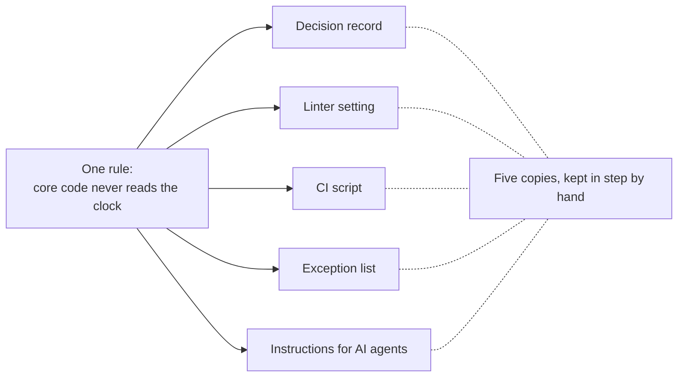
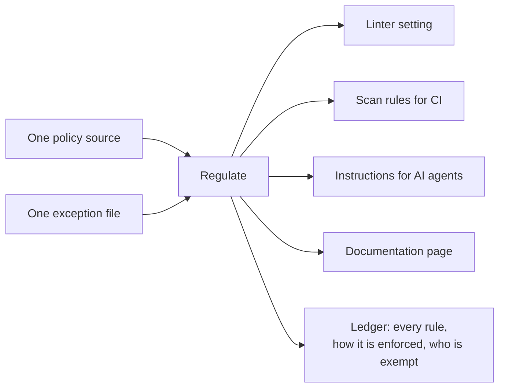

# Write the rule once

A pitch for Regulate, a proposed compiler that turns an engineering rule into the checks that enforce it. This document assumes no background.

> **Status.** Proposal, 14 November 2026. Regulate does not exist. The input and output shown here are illustrative designs.

## One rule, five copies

Suppose a team decides: **core code never reads the clock.** The reason is sound. The team replays recorded input to reproduce bugs, and a clock read makes two replays of the same input differ.

To make that rule real today, the team writes it down five times:

1. A decision record that states the rule and the reason.
2. A linter setting that rejects calls to the clock functions.
3. A script in continuous integration (CI) that searches for clock calls the linter misses.
4. A list of files that are allowed to break the rule, such as test fixtures.
5. A paragraph in the instructions file that AI coding agents read.



The five copies have no connection except the people who remember that they belong together.

## What goes wrong

**The record goes stale.** Someone tightens the linter setting and nobody updates the decision record. A year later the record describes a rule that no longer matches the code. Teams that number their records get a second problem: record 54 replaces record 12, and nothing on record 12 says so.

**The rule is rebuilt in every repository.** Two projects with the same rule write two enforcement scripts. One uses text search and the other parses the code. They disagree at the edges.

**Nobody knows what is enforced.** Some rules have a check. Some have only a paragraph. The paragraph does not say which kind it is.

**Exceptions pile up unseen.** Each tool has its own way to switch a rule off for one line. The suppressions carry no owner and no end date, and no list shows them all.

**AI agents make each of these worse.** An agent starts every session without the team's history. It reads the instructions file, and it can ignore the file. A survey of 831 engineers run for Black Duck in March 2026 reported that 97% of teams use AI coding tools and 30% have a fully governed approach to overseeing them. The article reporting that survey does not define "fully governed", so treat the second figure as a direction, not a measurement.

## The idea

Write the rule once, in a form a program can read. Let a compiler produce the other four copies.



The policy source and the exception file are the only things a person edits. Everything on the right is generated, and the ledger reports on all of it.

Regulate does not replace the linter, the CI system, or the test suite. It writes their configuration. The tools a team already trusts keep doing the enforcing.

## What it looks like

A policy file names a part of the repository and says which rules apply to it. This example is illustrative:

```graphql
"""
Governed code must not read the wall clock. A replay supplies time as data;
a clock read makes two runs of the same input diverge.
"""
interface NoWallClock
  @rustDisallow(methods: [
    { path: "std::time::SystemTime::now", use: "a caller-supplied timestamp" }
  ])

"The simulation kernel."
type WarpCore implements NoWallClock
  @governs(paths: ["crates/warp-core/**"])
```

From those lines, Regulate would generate the linter setting, with the rule's name and the suggested fix in the message a developer sees:

```toml
# Generated by regulate. Do not edit.
disallowed-methods = [
  { path = "std::time::SystemTime::now", reason = "[regulate:warp-core/no-wall-clock/rust-disallow] Use a caller-supplied timestamp." },
]
```

It would generate the paragraph for AI agents from the same description. And its ledger would list the rule as enforced, name the tool that enforces it, and count its exceptions.

## What a team gets

- **One place to change a rule.** Edit the policy file and rebuild. The linter setting, the scan rules, the agent instructions, and the documentation change together.
- **A build that fails on unenforced rules.** If no tool enforces a rule, the check fails until someone either adds enforcement or signs their name to "this one is manual".
- **Exceptions with owners and end dates.** One file lists every exception. An expired exception fails the check.
- **Policy changes that reviewers can see.** A pull request that removes a rule or adds an exception gets a summary that says so in plain words.
- **Rules that travel.** A set of rules can be shared between repositories at a pinned version, so two projects enforce the same thing.

## How it differs from what exists

| Existing approach | What it does well | What it leaves open |
| --- | --- | --- |
| Decision record tools | Record the reasoning | Enforce nothing; old records look current |
| Linters and code scanners | Enforce one kind of rule in one language | Do not know which written rule they implement |
| Infrastructure policy engines | Check cloud and deployment configuration | Do not address source code conventions |
| Service scorecards | Report compliance across services | Report after the fact; one vendor says its product does not "act as a PR gate" |
| Agent instruction sync tools | Keep several agent files identical | Guidance only; an agent can ignore it |
| Tools that attach a check to each decision record | Bind a decision to something that checks it | Keep the numbered decision log as the source; each check is written per decision |

Regulate sits between these. It holds the rule, generates configuration for the enforcing tools, and reports which rules have enforcement. The [landscape document](landscape-and-recommendation.md) compares named tools in detail.

## Who it is for

- **A maintainer of several repositories** who is tired of rebuilding the same checks in each one.
- **A staff engineer or architect** who owns the team's rules and wants proof they hold.
- **A team that works with AI coding agents** and needs its rules to be gates, not suggestions.
- **A team with replay, safety, or audit requirements** that has to show which rules are enforced and who approved each exception.

## What it does not do

- It does not analyse code. If no existing tool can check a rule, Regulate cannot check it either. It can only record the rule as manual.
- It does not write the test harnesses that prove deep properties. It can require that a harness exists and passes.
- It does not judge whether a rule is a good rule.
- It does not replace code review.

## Evidence so far

The front half of the compiler exists. Wesley, a GraphQL schema compiler, already turns files like the example above into a structured form that other programs read. Echo and Bunny use it that way to generate code.

For this proposal, the example policy files were run through Wesley 0.3.0-alpha.3. They lowered without error, and the structured output kept every rule, parameter, and grouping. Wesley's existing comparison command already reports "Directive @retry changed on Jobs" when a rule's parameter changes.

The back half, the part that produces linter settings and the ledger, is not written.

## The ask

A pilot spike: the smallest version that can fail. It takes one real policy, compiles it two ways, and compares the result against the hand-written checks it would replace. On 15 November 2026 it was planned as 25 tasks, about 54 estimated hours. The [executive summary](executive-summary.md) lists the four pass criteria.

If it passes, there is a concrete case for the next stage. If it fails, the cost was the spike and the result is a clear reason not to build it.
