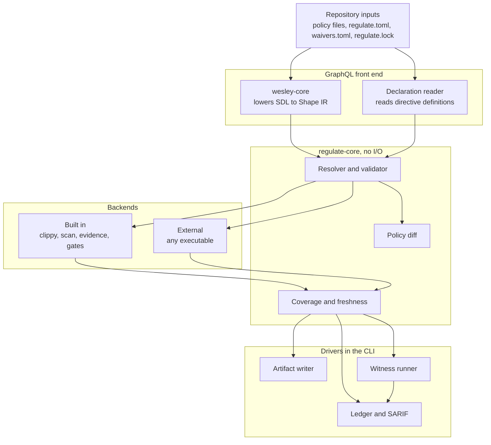
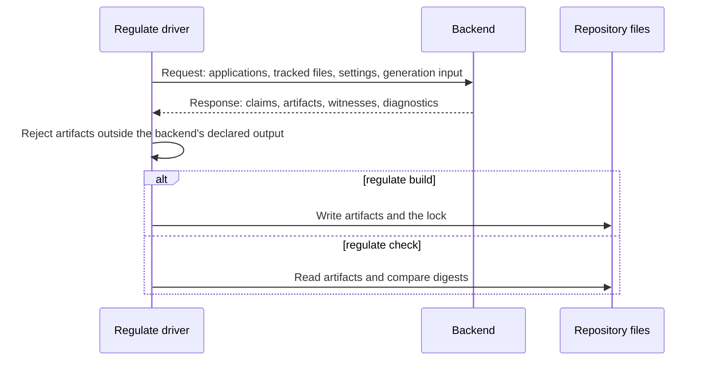

# Regulate technical design specification

How Regulate would be built: its architecture, data model, algorithms, backend protocol, test plan, and build plan. The [design specification](design-spec.md) defines what the tool does and the terms used here.

> **Status.** Proposal, 14 November 2026. No code exists. Type definitions, file formats, and messages in this document are designs and are labelled illustrative. Section 3 and appendix A report observed behaviour of Wesley and are labelled *observed*.

This document is for the person who builds or reviews the implementation. It assumes the design specification has been read, and some familiarity with Rust.

## 1. Scope

Regulate reads policy files, generates enforcement artifacts through backends, checks coverage and freshness, runs witnesses, and reports. This document specifies those functions to the level needed to start building and to estimate the work.

Out of scope: the content of shared packs, hosted services, and editor integration.

## 2. Architecture



The diagram shows repository inputs flowing through four groups. The front end turns text into data. The core turns data into a resolved policy model and decides what is covered and current. Backends turn the model into artifacts and witnesses. Drivers do everything that touches the file system or starts a process: they read the inputs, write artifacts and the lock, and run witnesses.

Two boundaries matter:

- **The core performs no input or output.** It receives file contents, the list of tracked files, and today's date as arguments. This makes every decision reproducible and testable without a file system.
- **The front end is replaceable.** The core consumes a `PolicyModel`. The GraphQL front end is one producer of that model. If GraphQL proves a poor authoring language, another front end can replace it without changing the core or any backend.

Proposed crate layout:

```text
crates/
  regulate-core/              policy model, resolver, validator, coverage, diff
  regulate-frontend-graphql/  SDL to PolicyModel, through wesley-core and apollo-parser
  regulate-backend-api/       request and response types for backends
  regulate-backends/          clippy, scan, evidence, gates, agents, docs
  regulate-cli/               the regulate binary
fixtures/                      policy sets and seeded source trees for tests
xtask/                         repository checks
```

## 3. What Wesley provides today

Wesley is the compiler front end. Its command `wesley schema lower` and its library function `wesley_core::lower_schema_sdl` turn GraphQL schema text into Shape IR, a JSON structure of types, fields, and directive applications.

The table reports behaviour *observed* on 14 November 2026 with `wesley` 0.3.0-alpha.3, built from commit `16e89a52`. Appendix A gives selected inputs and outputs.

| # | Probe | Observed result | Consequence for Regulate |
| ---: | --- | --- | --- |
| 1 | Directive applied to an object, interface, scalar, or field | Kept under `directives`, keyed by name, with arguments as JSON | The authoring model is expressible |
| 2 | Directive with no arguments | Lowered as `true` | Normalise to an empty argument object |
| 3 | Arguments containing nested input objects and lists | Kept verbatim; list order kept | Ordered composition can be written as lists |
| 4 | Several directives on one type | Source order kept | Not relied on |
| 5 | Directive declared `repeatable` | Two applications lower as an array; one application lowers as a single object | Normalise to a list |
| 6 | Non-repeatable directive applied twice | Rejected: `Lowering error: Duplicate non-repeatable directive '@retry' in directive` | One check comes free |
| 7 | Object or interface with no fields | Lowered | Subjects and profiles need no placeholder field |
| 8 | `implements`, including an interface that implements an interface | Kept as a list of names | Profiles and nested profiles are expressible |
| 9 | Descriptions on types and fields | Kept | Statements and reasons reach the IR |
| 10 | Directive definitions | Absent from the IR, with their descriptions, argument types, defaults, and locations | Regulate must read them itself |
| 11 | Wrong argument type, missing required argument, undeclared directive, wrong location, unknown enum value | All accepted without error | Regulate must validate applications |
| 12 | Omitted argument that has a default | Default not applied | Regulate must apply defaults |
| 13 | Directive on an enum value | Dropped; enum values lower as bare strings | Enum values cannot be subjects |
| 14 | Two definitions of one type name, or `extend type` | Merged without a message | Regulate must reject accidental duplicates |
| 15 | `implements` naming an undeclared interface | Accepted | Regulate must check |
| 16 | Two `--schema` flags, or a directory | Only the last file is lowered; a directory is rejected | Regulate concatenates sources and calls the library |
| 17 | `wesley schema hash` after a directive change | Hash changes | Usable for staleness detection |
| 18 | `wesley schema diff` | Reports each directive added, changed, or removed per type; marks additions `safe` and changes and removals `BREAKING` | Raw material for the policy diff |
| 19 | A regular expression as `"\\b…"` or as a block string `"""\b…"""` | Both lower to the same value | Block strings avoid double escaping |
| 20 | Fields and types of `input` objects | Kept, with base type, nullability, and list flag | Nested arguments can be type-checked from the IR |

Wesley also defines a contract for external generators in `wesley-core`, in `domain/extension_generation.rs`. It was read, not exercised:

- `ExtensionGenerationInputV1` carries the Shape IR and its digest, references to owner-declared artifacts outside the IR, a digest of the generator's settings, and the output roles requested.
- `GenerationProvenanceManifestV1` records the generator's identity, the input digest, and a digest for each emitted artifact. Its `verify` method takes the input, the generator bytes, and the artifact contents, and recomputes every digest.

Regulate uses this contract for its lock, in section 9.

### 3.1 What Regulate must add

From rows 10 to 16, the GraphQL front end has six duties that Wesley does not perform:

1. Read directive definitions from the source text with `apollo-parser`, the parser Wesley already depends on at version 0.8.
2. Check each application against its definition: argument names, types, required arguments, locations, and enum values.
3. Apply default argument values.
4. Normalise the three lowered shapes of an application (`true`, an object, an array) into one.
5. Reject two plain definitions of one type name, and reject `implements` of an unknown interface.
6. Concatenate source files in sorted path order before lowering.

### 3.2 Possible additions to Wesley

None is required for the spike.

- **Lower directive definitions.** A separate projection, not a change to Shape IR, so that existing hashes do not move. This would remove duty 1 and let other Wesley extensions validate their own directives.
- **A multi-file lowering helper.** This would remove duty 6.

The recommendation is to implement both duties in Regulate first and propose them to Wesley once their shape has held through one stage of real use.

## 4. Policy model

The core's central type. Illustrative Rust:

```rust
pub struct PolicyModel {
    pub bricks: BTreeMap<BrickName, Brick>,
    pub profiles: BTreeMap<ProfileName, Profile>,
    pub subjects: BTreeMap<SubjectId, Subject>,
    pub applications: Vec<Application>, // sorted by id
    pub waivers: Vec<Waiver>,
    pub manual: Vec<ManualAcknowledgement>,
}

pub struct Brick {
    pub name: BrickName,          // "rustDisallow"
    pub description: Option<String>,
    pub arguments: Vec<ArgumentSpec>,
    pub repeatable: bool,
    pub locations: BTreeSet<Location>,
    pub origin: Origin,           // built in, pack, or repository file and line
}

pub struct Subject {
    pub id: SubjectId,            // "warp-core"
    pub description: Option<String>,
    pub owner: Option<String>,
    pub paths: Vec<Glob>,
    pub profiles: Vec<ProfileName>, // transitive closure, sorted
    pub parts: Vec<Part>,
}

pub struct Application {
    pub id: ApplicationId,        // "warp-core/no-wall-clock/rust-disallow"
    pub subject: SubjectId,
    pub part: Option<PartId>,
    pub brick: BrickName,
    pub via: Via,                 // Direct, or Profile(name)
    pub args: serde_json::Value,  // validated, defaults applied
    pub paths: Vec<Glob>,
    pub statement: Option<String>, // the profile's or the subject's description
}

pub struct Waiver {
    pub policy: ApplicationId,
    pub item: Option<String>,
    pub path: Glob,
    pub reason: String,
    pub owner: String,
    pub expires: Expiry,          // a date, or Never
}
```

Every collection is ordered. The model serialises to canonical JSON, and that JSON is what backends receive.

## 5. Pipeline

One run of `regulate build` performs these stages in order. `check` stops before writing. `verify` continues into stage 12.

1. **Load configuration.** Parse `policy/regulate.toml`.
2. **Discover sources.** Expand `policy.sources` against the list of tracked files. Sort by path. Read each file.
3. **Read declarations.** Parse each file with `apollo-parser`. Collect directive definitions as bricks. Record the file and line of every definition and application for diagnostics. Reject duplicate type definitions.
4. **Lower.** Concatenate the built-in bricks, the packs, and the sources, and call `wesley_core::lower_schema_sdl`.
5. **Resolve.** Build subjects, profiles, parts, and applications from the IR, by the rules in section 6.
6. **Validate.** Check applications against bricks, and paths against tracked files, by the rules in section 7.
7. **Load exceptions.** Parse and validate waivers and manual acknowledgements.
8. **Prepare generation input.** Build one `ExtensionGenerationInputV1` per backend.
9. **Run backends.** Collect claims, artifacts, witnesses, and diagnostics.
10. **Check coverage.** Every application needs an enforcing or delegated claim, or a manual acknowledgement.
11. **Emit or compare.** `build` writes artifacts and the lock. `check` compares them with what is on disk.
12. **Run witnesses.** `verify` only.
13. **Report.**

The list of tracked files comes from `git ls-files`. Using tracked files, not the working directory, keeps results independent of build output and editor files.

## 6. Resolution rules

**Subjects.** An object type with a `@governs` directive is a subject. An object type without one is an error.

**Profiles.** Every interface is a profile. A subject's profile set is the transitive closure of its `implements` list. Regulate does not require a subject to list inherited interfaces, although GraphQL does. A cycle is an error.

**Parts.** A field with a `@governs` directive is a part. Every tracked file a part matches must also be matched by its subject.

**Applications.** For subject `S`:

- Each brick on a profile `P` in the closure produces an application with identifier `S/P/brick`.
- Each brick written on `S` itself produces `S/brick`.
- Each brick on a part `p` produces `S.p/brick`.

`@governs` and `@owner` describe the subject and produce no application.

**Applications add up.** If a profile and the subject both apply the same brick, both applications exist. For list-valued bricks such as ban lists, a backend merges them. For single-valued bricks such as `@retry`, the backend reports a conflict. There is no override in the first version, so adopting a profile can never be weakened by a later line. Open question 2 in the design specification covers the alternative.

**Repeatable bricks.** A repeatable brick must declare a required `name: String!` argument. The identifier ends with `:name`, as in `warp-core/witness:dind`. Names must be unique within a subject.

**Identifiers.** Type, field, and directive names are converted to kebab case: `WarpCore` becomes `warp-core`, and `rustDisallow` becomes `rust-disallow`. Two names that convert to the same identifier are an error.

**Paths.** Globs use gitignore-style syntax relative to the repository root. Subjects may overlap. A file can be governed by several subjects, and `regulate explain` lists all of them.

## 7. Validation and diagnostics

Each diagnostic has a stable code, a file and line where one applies, and a sentence that says how to fix it. Illustrative catalogue for the first version:

| Code | Condition | Reported by |
| --- | --- | --- |
| `REG-S001` | A policy file does not parse, or Wesley rejects it | `build`, `check` |
| `REG-S002` | One type name is defined twice | `build`, `check` |
| `REG-V001` | A directive is applied but not declared | `build`, `check` |
| `REG-V002` | An argument has the wrong type, or an enum value is unknown | `build`, `check` |
| `REG-V003` | A required argument is missing | `build`, `check` |
| `REG-V004` | A directive is applied at a location its declaration does not allow | `build`, `check` |
| `REG-R001` | An object type has no `@governs` | `build`, `check` |
| `REG-R002` | `implements` names an unknown interface, or profiles form a cycle | `build`, `check` |
| `REG-R003` | A part matches a file its subject does not | `build`, `check` |
| `REG-R004` | A glob matches no tracked file | `build`, `check`; warning |
| `REG-C001` | An application has no enforcing or delegated claim and no acknowledgement | `check` |
| `REG-C002` | A manual acknowledgement names an application that has a claim, or does not exist | `check` |
| `REG-F001` | A committed artifact differs from the generated one | `check` |
| `REG-F002` | The lock is missing or does not match the policy input | `check` |
| `REG-W001` | A waiver names an unknown application or item | `check` |
| `REG-W002` | A waiver's path matches no tracked file | `check` |
| `REG-W003` | A waiver has expired | `check` |
| `REG-X001` | A backend failed, timed out, or returned an invalid response | `build`, `check` |
| `REG-X002` | A backend returned an artifact outside its declared output | `build`, `check` |
| `REG-X003` | A witness could not be started or timed out | `verify` |

Argument validation is a type check of GraphQL input values against the declared types: the built-in scalars, enums, input objects, lists, and non-null. Row 20 in section 3 confirms that the IR carries the input types this needs.

## 8. Backend protocol

A backend is a function from a request to a response. A built-in backend is called in process. An external backend is an executable that receives the request as JSON on standard input and writes the response as JSON on standard output.



The backend never writes a file. The driver does, after it has checked the response. That makes `check` possible without a second code path in every backend, and it lets the driver refuse a write outside the declared output.

### 8.1 Request

Illustrative and abridged:

```json
{
  "apiVersion": "regulate.backend-request/v1",
  "backend": { "name": "clippy", "settings": {} },
  "applications": [
    {
      "id": "warp-core/no-wall-clock/rust-disallow",
      "subject": "warp-core",
      "brick": "rustDisallow",
      "via": { "profile": "NoWallClock" },
      "args": {
        "methods": [
          { "path": "std::time::SystemTime::now", "use": "a caller-supplied timestamp" }
        ]
      },
      "paths": ["crates/warp-core/**"],
      "statement": "Governed code must not read the wall clock.",
      "waivers": []
    }
  ],
  "files": ["crates/warp-core/Cargo.toml", "crates/warp-core/src/lib.rs"],
  "generationInput": { "apiVersion": "wesley.extension-generation-input/v1" }
}
```

A backend receives every application, not only the ones it will claim, so that it can report conflicts. `files` is the sorted list of tracked files under any governed path. `generationInput` is the full Wesley structure; it is shortened here.

### 8.2 Response

Illustrative:

```json
{
  "apiVersion": "regulate.backend-response/v1",
  "claims": [
    {
      "application": "warp-core/no-wall-clock/rust-disallow",
      "kind": "enforcing",
      "witness": "clippy:warp-core"
    }
  ],
  "artifacts": [
    {
      "path": "crates/warp-core/.clippy.toml",
      "mode": "file",
      "content": "# Generated by regulate (backend: clippy). Do not edit.\n"
    }
  ],
  "witnesses": [
    {
      "id": "clippy:warp-core",
      "run": ["cargo", "clippy", "-p", "warp-core", "--all-targets", "--", "-D", "clippy::disallowed_methods"],
      "marker": "\\[regulate:([^\\]]+)\\]"
    }
  ],
  "diagnostics": []
}
```

| Field | Meaning |
| --- | --- |
| `claims[].kind` | `enforcing`, `delegated`, or `informational` |
| `claims[].witness` | For an enforcing claim, the witness that proves it |
| `artifacts[].mode` | `file` replaces a whole file. `block` replaces the text between two marker comments in an existing file, for targets such as `AGENTS.md`. |
| `witnesses[].run` | The command, as an argument list. No shell is involved. |
| `witnesses[].marker` | A regular expression whose first group is an application identifier. Section 11 explains its use. |

### 8.3 Rules for backends

- **Deterministic.** The same request produces a byte-identical response.
- **No side effects.** A backend reads only its request and writes only its response.
- **Honest claims.** A backend claims an application as enforcing only if its witness fails when the rule is broken. The test plan checks this for each built-in backend with a seeded violation.
- **Refuse what cannot be enforced.** If the target cannot express an application, the backend returns a diagnostic and no claim. The application then shows as unclaimed.

### 8.4 Relation to Wesley's generator contract

For each backend, the driver builds an `ExtensionGenerationInputV1` with:

- the Shape IR of the lowered policy;
- no operations and no law;
- owner declarations that reference `regulate.toml`, `waivers.toml`, and each pack by digest;
- a digest of the backend's settings;
- one projection role, the backend's name.

After the backend responds, the driver builds a `GenerationProvenanceManifestV1` from that input, the backend's identity, and the digests of the returned artifacts.

One point is unsettled. Wesley's generator identity is a digest of the generator's bytes. That is well defined for a compiled backend and unclear for a backend that is a script with dependencies. Section 20 lists this as a decision.

## 9. Lock and freshness

`policy/regulate.lock` is JSON. Illustrative and abridged:

```json
{
  "apiVersion": "regulate.lock/v1",
  "wesleyCore": "0.3.0-alpha.3",
  "policyInputDigest": "sha256:…",
  "backends": [
    {
      "name": "clippy",
      "provenance": { "apiVersion": "wesley.generation-provenance-manifest/v1" }
    }
  ]
}
```

`regulate check` decides freshness in three steps:

1. Rebuild the generation input from the current policy files. If its digest differs from the lock, the lock is stale: `REG-F002`.
2. Run each backend and compare each returned artifact with the committed file, byte for byte. A difference is `REG-F001`, and the message names the file.
3. Call the provenance manifest's `verify` method with the current input and artifact contents.

Step 2 alone would detect every stale artifact. The lock adds a record of which generator version produced the committed files, which matters when a backend upgrade changes output.

## 10. Waivers

A waiver is matched by application identifier, optional item, and path. Its effect depends on what the target supports:

| Backend | How a waiver takes effect |
| --- | --- |
| `scan` | The scanner skips a match when a waiver covers its application, item, and file |
| `eslint` | The backend adds a per-file override to the generated configuration |
| `clippy` | Clippy accepts exceptions only as attributes in source. The backend adds scan patterns that find `allow` and `expect` attributes for the generated lints, and the scan fails unless a waiver covers the file. This is the suppression audit, planned for stage 2. |
| `evidence`, `gates` | Not applicable in the first version |

The date used to judge expiry is an input to the core. The CLI passes today's date, and `--as-of` overrides it for tests and for answering "what expires before the release?".

The scanner also reports a waiver that matched nothing. The first version reports it as a warning. A later version can make it an error once teams trust it.

## 11. Witnesses and attribution

`regulate verify` runs each witness once, from the repository root, with a timeout, and captures its output. Exit status 0 is a pass.

A witness can cover several applications. Attribution works in two steps:

1. A failing witness marks every application it covers as failing.
2. If the witness has a `marker` and the output contains matches, only the applications named in the output are marked as failing. The others pass.

This is why generated lint messages carry `[regulate:<id>]`. Without a marker, one Clippy failure would mark every rule in the crate as failing.

`--only <subject>` restricts the run to one subject. `--changed <revision>` restricts it to subjects that govern a file changed since that revision. Echo's CI does the same today with `scripts/classify_changes.cjs`.

Exit status for all commands:

| Status | Meaning |
| ---: | --- |
| 0 | Success |
| 1 | The policy is not satisfied: a violation, an unclaimed application, a stale artifact, or an expired waiver |
| 2 | The input is invalid: a syntax, validation, or configuration error |
| 3 | Regulate, a backend, or a witness could not run |

`regulate report --format sarif` emits one SARIF rule per application and one result per failure. The built-in scanner supplies exact file and line. For other witnesses, a location is present only when the backend supplies a parser for the tool's output, which is a later addition.

## 12. Policy diff

`regulate diff <revision>` builds the policy model twice: once from the working tree, once from policy files read out of the other revision with `git show`. It compares the two models by application identifier.

| Change | Direction |
| --- | --- |
| Application added | Strengthens |
| A subject's paths match more files | Strengthens |
| Waiver removed, or its expiry brought forward | Strengthens |
| Application removed | Weakens |
| A subject's paths match fewer files | Weakens |
| Waiver added, or its expiry moved later | Weakens |
| Manual acknowledgement added | Weakens |
| An application's arguments changed | Unknown |

The diff works on resolved models, not on Wesley's `schema diff`, because a one-line change to a profile changes applications on every subject that adopts it. Wesley's comparison sees one changed interface. Regulate has to report each affected subject.

`--fail-on weakens` makes the command exit with status 1 when any change weakens policy. A team can use that to require an extra approval.

## 13. Built-in backends

| Backend | Claims | Emits | Witness | Stage |
| --- | --- | --- | --- | ---: |
| `clippy` | `@rustDisallow` | `.clippy.toml` in each crate under the subject's paths | `cargo clippy` for those crates | 0 |
| `scan` | `@banPatterns` | Nothing | The built-in scanner | 0 |
| `evidence` | `@requiresPaths`, `@witness` | Nothing | A file-existence check; the named command | 1 |
| `gates` | `@gates` | A JSON gate map | None; delegated | 1 |
| `agents` | Every application, as informational | A managed block in an agent instructions file | None | 2 |
| `docs` | Every application, as informational | One Markdown page per subject | None | 2 |

**`clippy`.** The backend finds crate roots by looking for `Cargo.toml` among the tracked files under a subject's paths. It writes one `.clippy.toml` per crate, with `disallowed-methods`, `disallowed-types`, and `disallowed-macros` entries. Each entry's `reason` starts with the marker. If a subject's paths do not line up with crate roots, the backend returns a diagnostic and no claim, because Clippy's configuration cannot be scoped below a crate. Settings that are not policy, such as complexity thresholds, pass through from `regulate.toml`.

**`scan`.** The scanner reads each tracked file under an application's paths and tests each line against each pattern with the Rust `regex` crate. That crate runs in time linear in the input and has no backreferences or lookaround. The patterns in Echo's scripts use word boundaries and POSIX classes, which it supports. Echo's `determinism-scan.sh` calls ripgrep when it is installed, which uses the same regular-expression engine, and falls back to Perl otherwise. It passes ripgrep's smart-case flag, so an all-lowercase pattern matches without regard to case. The built-in scanner must either reproduce that or drop it on purpose; test R-SCAN-1 exposes the difference either way. The scanner does not distinguish code from comments or strings. Echo's script has the same property and calls its patterns "conservative and intentionally annoying".

**`gates`.** Illustrative output:

```json
{
  "subjects": [
    {
      "id": "warp-core",
      "owner": "Architect",
      "paths": ["crates/warp-core/**"],
      "gates": ["G1", "G2", "G3", "G4"]
    }
  ]
}
```

**`agents`.** For each subject, the block lists its paths, the description of each profile it adopts, and the command `regulate explain <path>`. The block states that the rules are enforced in CI, so an agent has no reason to treat them as optional.

## 14. Security and trust

| Concern | Position |
| --- | --- |
| A policy file names a witness command | Policy files can make CI run any command. They need the same review as CI configuration. A code-owner rule on `policy/` is the practical control. |
| An external backend is arbitrary code | Regulate runs only backends listed in the committed configuration. It does not download backends. |
| A backend writes where it should not | The driver, not the backend, writes files, and it rejects paths outside the declared output and paths with traversal. |
| A shared pack changes | Packs are pinned by digest. A mismatch is an error before lowering. |
| A waiver is added quietly | Waivers appear in `regulate diff` as weakening changes. `--fail-on weakens` can gate them. |
| A generated artifact is edited by hand | `regulate check` detects the difference. |
| A suppression comment bypasses a rule | Covered only where the suppression audit exists. Until then this is a known gap. |

Regulate is not a security boundary. A contributor with write access to `policy/` and to CI configuration can disable it, as with any CI check.

## 15. Determinism and performance

Every output is a function of the tracked files, the configuration, and the date passed to the core. Collections are ordered, JSON is canonical, and no output contains a timestamp or an absolute path. Two builds on different machines produce identical bytes. Regulate should itself adopt the `NoWallClock` and `OrderedContainersOnly` profiles in its core crate.

Performance targets, not measurements:

- `regulate check` on a repository with 100 subjects finishes in under one second, excluding external backends.
- The scanner processes source text at a rate comparable to a plain regular-expression search over the same files.

`verify` takes as long as the witnesses it runs.

## 16. Test plan

Nothing in this section has been run. Each row is planned evidence, with the exact result that would count as a pass.

| Requirement | Claim | Planned test | Fixture | Exact oracle |
| --- | --- | --- | --- | --- |
| R-RESOLVE-1 | The example policy resolves to its applications | Unit test on the resolver | The files in section 3.2 of the design specification | Exactly six identifiers: `warp-core/gates`, `warp-core/no-wall-clock/ban-patterns`, `warp-core/no-wall-clock/rust-disallow`, `warp-core/ordered-containers-only/rust-disallow`, `warp-core/requires-paths`, `warp-core/witness:dind` |
| R-VALID-1 | A wrong argument type is rejected | CLI test | A subject with `@rustDisallow(methods: "x")` | Exit status 2; one diagnostic `REG-V002` naming the file and line |
| R-COVER-1 | An unclaimed application fails the check | CLI test | A brick with no backend configured | Exit status 1; one diagnostic `REG-C001` naming the application |
| R-FRESH-1 | A hand-edited artifact is detected | CLI test | A built tree with one byte changed in `.clippy.toml` | Exit status 1; `REG-F001` naming that path |
| R-SCAN-1 | The scanner finds what Echo's script finds | Differential test | A copy of `warp-core` with seeded violations | The set of (rule, path, line) equals the set printed by `scripts/ban-nondeterminism.sh` on the same tree |
| R-CLIPPY-1 | The generated Clippy configuration enforces the rule | Integration test that runs real Clippy | A fixture crate that calls `SystemTime::now` | `cargo clippy` fails and its output contains the marker for that application; it passes after the call is removed |
| R-WAIVE-1 | An expired waiver fails the check | CLI test with `--as-of` | A waiver that expires the day before | Exit status 1; `REG-W003` naming the waiver |
| R-DIFF-1 | A removed application is reported as weakening | CLI test | Two policy revisions | The removed identifier appears under "Weakens"; `--fail-on weakens` exits with status 1 |
| R-DET-1 | Output is reproducible | Build twice, in two directories, on Linux and macOS | The example policy | Every artifact and the lock are byte-identical across all four builds |
| R-PROTO-1 | A backend cannot write outside its output | CLI test with a test backend | A backend that returns `../../etc/x` | Exit status 3; `REG-X002`; no file written |

Integration tests run the real tools. A test that replaced Clippy with a stand-in would show only that the generated text has the expected shape, which is not the claim.

## 17. What is needed to build it

- **People.** One engineer who knows Rust and has read Wesley's core crate. A second person to review the policy model before stage 1.
- **Libraries.** `wesley-core` at an exact pinned version; `apollo-parser`; `serde`, `serde_json`, and `toml`; a glob library; `regex`; `sha2`; a command-line parser.
- **Tools on the test machines.** Git, a Rust toolchain with Clippy, and for stage 2, Node.js for an ESLint backend.
- **Test beds.** Echo and Bunny, with permission to change their CI.
- **Infrastructure.** A repository and CI on Linux and macOS. No server, database, or network service.
- **Decisions.** The open ones in the executive summary, and those in section 20.

## 18. Build plan

Estimates are judgement, for one engineer. They are not measurements. The spike figure comes from a task-by-task plan in the repository's issues; stages 1 and 2 have not been broken down and are likely to grow when they are.

| Stage | Deliverables | Exit criteria | Estimate |
| --- | --- | --- | --- |
| **0. Spike** | GraphQL front end that reads declarations; resolver; `clippy` and `scan` backends; `build` and `check`; one agent-rules output added afterwards. Argument validation covers only the bricks used. | The four criteria in the executive summary | About 52 hours in 24 tasks |
| **1. Internal adoption** | Full validation; waivers; `evidence` and `gates` backends; `verify`, `report`, `explain`, `diff`; the test plan in section 16 passing | Echo and Bunny run `check` and `verify` in CI. The Echo scripts and lists that Regulate replaces are deleted. | 2 to 3 weeks |
| **2. Wider use** | External backend protocol; an ESLint backend; `agents` and `docs` backends; packs with digest pinning; suppression audit; SARIF | A third repository, in another language, adopts Regulate with no change to the core. Echo and Bunny share one determinism pack. | 3 to 4 weeks |
| **3. Publication** | Documentation, importers, release packaging | Decided after stage 2, from the evidence in the landscape document | Not estimated |

Method:

- **Differential testing first.** Each replaced script stays until Regulate reproduces its findings on a seeded tree.
- **Use it on itself.** Regulate's own repository carries a `policy/` directory from stage 1.
- **One backend per change.** Each backend arrives with its seeded-violation test.

## 19. Risks

| Risk | Consequence | Response |
| --- | --- | --- |
| GraphQL reads badly as a policy language | Authors avoid the tool | The front end is replaceable. The spike's second criterion measures size, and review of the spike judges readability. |
| Backends inherit their targets' limits | Some rules cannot be expressed | The backend refuses, the application shows as unclaimed, and `@witness` remains as an escape hatch |
| Wesley changes before 1.0 | Rework in the front end | Pin an exact version, as Echo does. Echo pins 0.3.0-alpha.2 and Bunny pins 0.0.5 today, so version spread is already real. |
| Generated files conflict with hand-written settings | Adoption stalls | Pass-through settings; importers in stage 3 |
| The ledger says "enforced" when CI does not run the witness | False assurance | `verify` runs witnesses itself. Delegated claims are labelled as such. |
| The tool grows into a framework | Cost exceeds the value for a handful of repositories | Stage gates with stop conditions. The fallback in the landscape document is always available. |
| One maintainer | The tool stalls | Keep the core small. Committed artifacts keep working without Regulate. |

## 20. Decisions needed

1. **Where directive definitions are read.** In Regulate, or in Wesley as a new projection. Recommended: Regulate first.
2. **Generator identity for script backends.** A digest of the entry file, a declared version string, or a digest of a lock file. Recommended: a declared version string in `regulate.toml` until a real case needs more.
3. **Whether artifacts are committed.** Recommended: yes.
4. **Whether a subject may have no fields.** Wesley accepts it. Recommended: allow it, and document the placeholder form for teams whose editor tooling objects.
5. **The Wesley version to pin.** Recommended: the newest release that includes the generator contract.

## Appendix A. Wesley observation log

All output in this appendix is *observed*, from `wesley` 0.3.0-alpha.3 built at commit `16e89a52` on 14 November 2026. Output is abridged where noted.

**A directive with nested arguments, lowered.** Input:

```graphql
directive @governs(paths: [String!]!) on OBJECT
directive @witness(name: String!, run: [String!]!) repeatable on OBJECT
type WarpCore implements Deterministic
  @governs(paths: ["crates/warp-core/**"])
  @witness(name: "dind", run: ["cargo", "xtask", "dind"])
```

Output of `wesley schema lower --schema <file> --json`. The output has one entry in `types`, shown here with whitespace condensed:

```json
{
  "name": "WarpCore",
  "kind": "OBJECT",
  "directives": {
    "governs": { "paths": ["crates/warp-core/**"] },
    "witness": { "name": "dind", "run": ["cargo", "xtask", "dind"] }
  },
  "implements": ["Deterministic"]
}
```

The directive definitions do not appear anywhere in the output.

**Invalid applications, accepted.** Input:

```graphql
directive @retry(max: Int!) on OBJECT
type A @retry(max: "five") { _: Boolean }
```

The lowered directives for `A`:

```json
{ "retry": { "max": "five" } }
```

**A duplicate application, rejected.** Input:

```graphql
directive @retry(max: Int!) on OBJECT
type D @retry(max: 1) @retry(max: 2) { _: Boolean }
```

Output, with exit status 1:

```text
Lowering error: Duplicate non-repeatable directive '@retry' in directive
```

**A policy change, compared.** The old file applies `@retry(max: 5, …)` and `@noRandom` to `Jobs`. The new file changes `max` to 3, widens `@governs`, drops `@noRandom`, and adds a `Billing` type. Output of `wesley schema diff --old <old> --new <new>`:

```text
BREAKING  Directive @governs changed on Jobs
BREAKING  Directive @retry changed on Jobs
BREAKING  Directive @noRandom removed from Jobs
safe      Type "Billing" added
```

**The example policy, hashed.** The three example files are attached: the [proposed standard bricks](../../fixtures/example-policy/bricks/standard.graphql), the [determinism profiles](../../fixtures/example-policy/profiles/determinism.graphql), and the [warp-core subject](../../fixtures/example-policy/subjects/warp-core.graphql). Concatenated in that order, they lower without error. `wesley schema hash` prints:

```text
daf6f7c4a810f652a0a5f84c4e18d14669a37d7e364f216f34e24b49b63a8042
```
